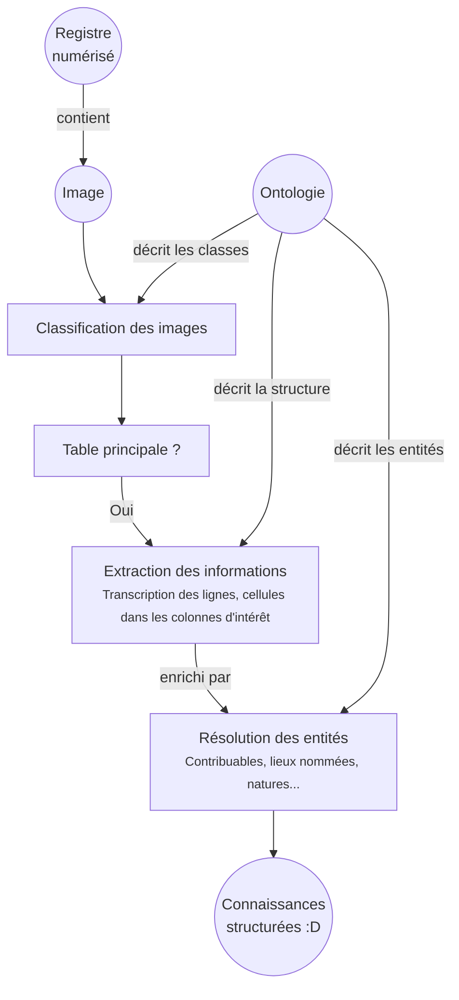

# Présentation SFO 16/11/2026

I. Introduction
- Sujet de thèse
- Usage généraliste
- Problématiques de recherche
- Inventaire global
- Introduction des zones d'études

II. Analyse critique et problématiques
- Fixité des plans
- Variabilités dans les états de sections
- Variabilité dans les matrices

III. Approaches de traitement automatique
- Ontologie
- Algorithme de peuplement
- Extraction auto

IV. Quelques examples développés

V. Conclusion cadastre-sfo

## Installation
```bash
uv venv .quartoenv --python 3.13
uv pip install -r requirements.txt
export QUARTO_PYTHON=$PWD/.quartoenv/bin/python
```

## Render slides
```bash
quarto preview slides/intro.qmd   # live preview in the browser, reloads when you save
quarto render slides/intro.qmd    # builds slides/intro.html
```

## Tests
