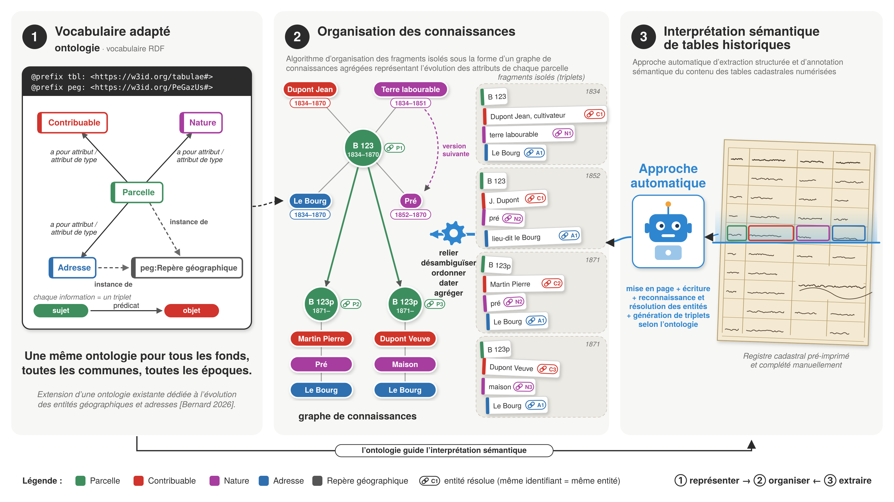

# Conclusion

## Conclusion

<figure style="text-align: center;">
    
</figure>

## Perspectives

:::{.nonincremental}

* Poursuivre le **développement de l'ontologie** ➡️

* **Nouvelle version de l'algorithme de peuplement du graphe de connaissances** :  @bernard_pegazus_2026
    * Ajout du module lié à l'ambiguité des numéros de parcelles.

* **Mise à jour de la chaîne de traitement testée avec les états de sections**
    * Modèles d'extraction d'informations plus récents
    * Différentes stratégies de résolution d'entités
    * Jeux de données étendus pour l'évaluation (et l'entraînement)

* **Visualisation et interrogation des graphes de connaissances**
    * Extraction des formes et textes sur les plans pour permettre une **représentation cartographique** du graphe.
:::

## Références

::: {#refs}
:::

## Merci pour votre attention !

:::{.nonincremental}
* Thèse : <a href="https://theses.fr/2025UEFL2118" target="_blank">https://theses.fr/2025UEFL2118</a> | Ressources : <a href="https://solenn-tl.github.io/#resources" target="_blank">https://solenn-tl.github.io/#resources</a>

<figure style="text-align: center;">
    
</figure>
:::