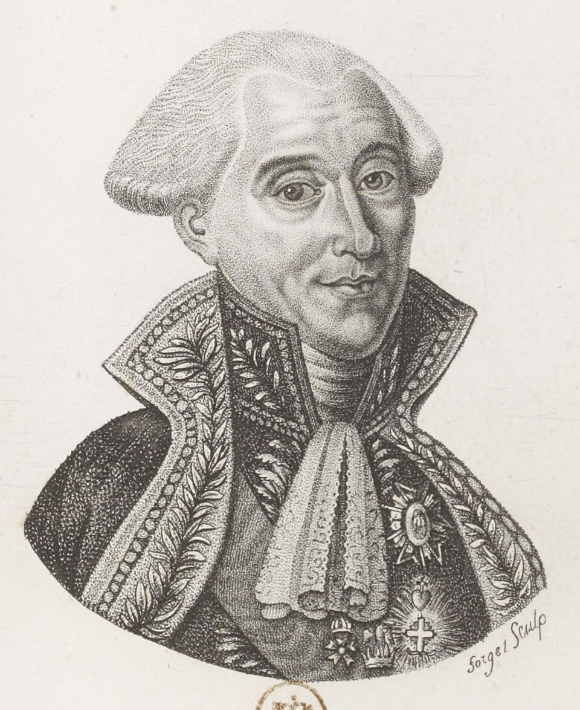

# Introduction

## Thèse 

<strong>Reconstitution automatique de la généalogie des parcelles et des bâtiments à partir de sources historiques</strong>

::: {.nonincremental}
* Sciences et Technologies de l'Information Géographique
* Co-financement Institut National de l'Information Géographique et Forestière (IGN) et Agence d'Innovation de Défense (AID)
* Laboratoire LASTIG, Université Gustave Eiffel, IGN-Géodata Paris
* <a href="https://theses.fr/2025UEFL2118" target="_blank">theses.fr/2025UEFL2118</a>
:::

::: {.notes}
- Ajouter les logos.
:::

## Contexte : production de données spatio-temporelles
::: {.nonincremental}
* Dates de construction, modifications et destructions des bâtiments
:::

::: {.notes}
- Dates de bâtiments (hors bâtiment inventoriés, inscrits, classés): données déclaratives.
- Les bases de données actuelles sont incomplètes, comportent des imprécisions et des erreurs.
:::

## Contexte : production de données spatio-temporelles
::: {.nonincremental}
* Evolution de l'occupation et de l'usage du sol
:::

::: {.notes}
- Données spatio-temporelles: données géographiques qui permettent de décrire l'évolution d'un territoire sur une période de temps donnée.
- OC/OS: Pas de sources avec une résolution temporelle fine avant la Seconde Guerre mondiale
:::

## Contexte : production de données spatio-temporelles

<strong>Quelles sources documentaires utiliser pour accéder à de telles connaissances ?</strong>

::: {.nonincremental .checklist}
- [ ] Très grande échelle
- [ ] Continuité temporelle
- [ ] Temps long
:::

::: {.notes}
* La question qui se pose donc à ce stade est donc de savoir quelles sources pourraient être utilisées pour remonter dans le temps à des échelles très précises, de l’ordre de celle du bâtiment.
* Pourquoi ne pas utiliser le cadastre actuel => on ne peut pas revenir au delà ce qui existe actuellement ? Et par ailleurs, données sensibles.
:::

## Contexte : production de données spatio-temporelles

<strong>Quelles sources documentaires utiliser pour accéder à de telles connaissances ?</strong>

::: {.nonincremental .checklist}
- [ ] Très grande échelle
- [ ] Continuité temporelle
- [ ] Temps long
:::

<strong>Le cadastre ancien / cadastre napoléonien</strong>

## Le cadastre parcellaire ancien

:::: {.columns}

::: {.column width="60%"}
* Objectif : <strong>rationaliser l'évaluation des revenus fonciers et la perception de l’impôt associé à l'échelle nationale</strong>
* Institué par la loi du 15 septembre 1807.
* Période de production initiale : 1808 - 1850
* Période (maximale) d'utilisation : 1808 - 1975(~)
* Context (économique, politique et juridique) évolutif sur toute la période !
:::

::: {.column width="40%"}

    <figure>
        
        <figcaption>Portrait de Martin-Michel Gaudin, duc de Gaité. <a href="https://gallica.bnf.fr/ark:/12148/btv1b8453983r" target="_blank">@ Bibliothèque nationale de France</a></figcaption>
    </figure>

:::

::::

::: {.notes}
* Plusieurs systèmes pour consigner les parcelles et contribuables associés.
* Des initiatives régionales/partielles au 18ème siècle/tout début 19ème siècle: mappes Sardes, cadastre de Guyenne, plans de masses de la région parisienne, etc.
* Nombreuses discussions et débats sur la raison d'être d'un cadastra parcellaire, les modalités de son contenu et de production du cadastre.
* Période d'utilisation très longue globalement, variable localement.
:::

## Problématiques de recherche
* Comment extraire automatiquement des connaissances sur les parcelles à partir de documents cadastraux anciens ?
* Comment organiser et structurer ces connaissances suivant une logique spatio-temporelle qui permette de rendre accessible l'évolution des parcelles, des bâtiments et autres repères géographiques sur le temps long ?