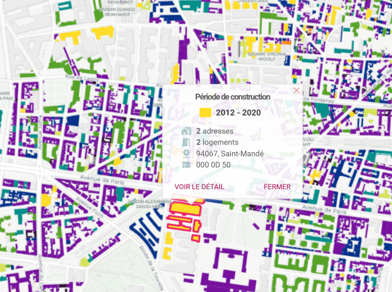
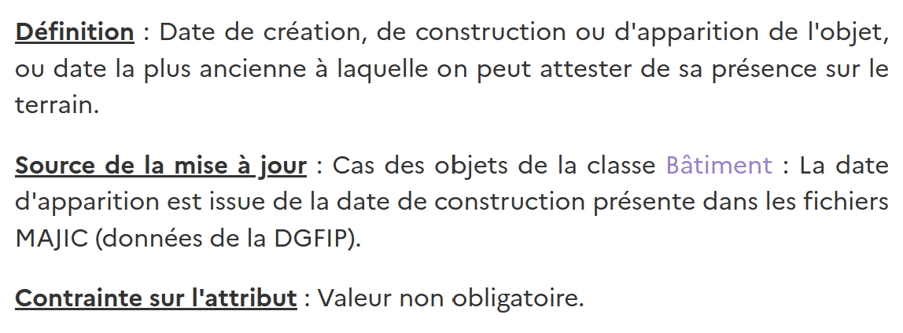
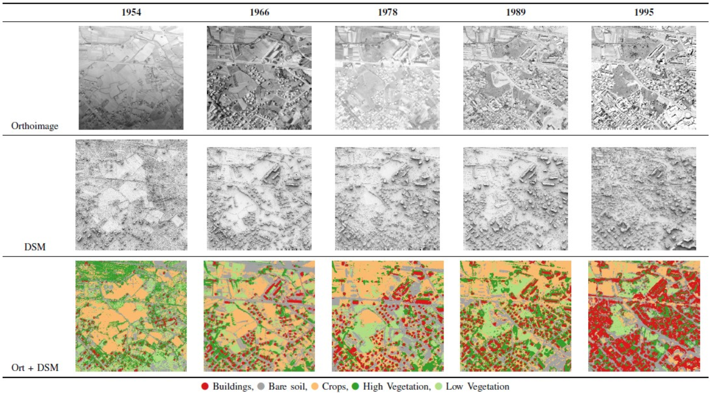
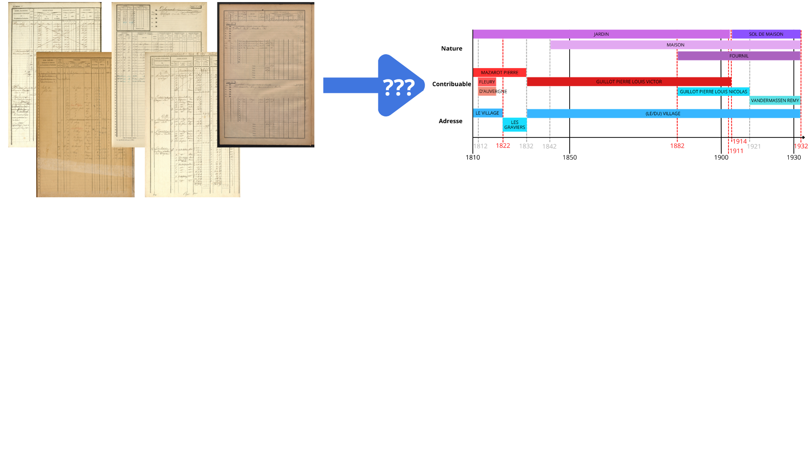

# Introduction

## Thèse 

<strong>Reconstitution automatique de la généalogie des parcelles et des bâtiments à partir de sources historiques</strong>

::: {.nonincremental}
* Mention <i>Sciences et Technologies de l'Information Géographique</i>
* <a href="https://www.umr-lastig.fr/">Laboratoire LASTIG</a>, Université Gustave Eiffel, IGN-Géodata Paris
    * Encadrement : Nathalie Abadie (LASTIG), Joseph Chazalon (LRE, EPITA), Bertrand Duménieu (CNRS-EHESS) et Julien Perret (directeur de thèse, LASTIG)
* Co-financement Institut National de l'Information Géographique et Forestière (IGN) et Agence d'Innovation de Défense (AID)
* Support technique de <a href="https://www.teklia.com/">Teklia</a>.
* Publication des <a href="https://solenn-tl.github.io/#resources">données et codes</a> suivant les principes de la science ouverte.
* Manuscrit : <a href="https://theses.fr/2025UEFL2118" target="_blank">theses.fr/2025UEFL2118</a>
:::

::: {.notes}
- Ajouter les logos.
:::

## Contexte : production de données spatio-temporelles
::: {.nonincremental}
* Dates de construction, modification et destruction des bâtiments.
:::

:::: {.columns .incremental}

::: {.column width="50%"}

    <figure>
        
        <figcaption>Carte des dates d'apparition des bâtiments autour de l'IGN à Saint Mandé. <a href="https://app.urbs.fr/onb/map">Carte U.R.B.S, données MAJIC (CEREMA), 2025</a>.</figcaption>
    </figure>

:::

::: {.column width="50%"}

<figure>
    
    <figcaption>Définitition de la propriété <b>Date d'apparition</b>. 
    Extrait de la documentation de la <a href="https://bdtopoexplorer.ign.fr/?attr_communs_total#attribute_5">base de données topographique de l'IGN (BDTOPO)</a>.</figcaption>
</figure>

:::

::::

::: {.notes}
- Dates de bâtiments (hors bâtiment inventoriés, inscrits, classés): données déclaratives.
- Utile pour déterminer les bâtiments nécessitant une mise en conformité au regard des normes d'isolation thermique.
- Les bases de données actuelles sont incomplètes, comportent des imprécisions et des erreurs.
:::

## Contexte : production de données spatio-temporelles
::: {.nonincremental}
* Evolution de l'occupation et de l'usage du sol.
:::

<figure>
    
    <figcaption>Cartes d'occupation du sol entre 1954 et 1995 produites à partir d'images aériennes. 
    Source: @hiatus</figcaption>
</figure>

::: {.notes}
- Données spatio-temporelles: données géographiques qui permettent de décrire l'évolution d'un territoire sur une période de temps donnée.
- OC/OS: Pas de sources avec une résolution temporelle fine avant la Seconde Guerre mondiale
:::

## Contexte : production de données spatio-temporelles

<strong>Quelles sources utiliser pour produire des données spatio-temporelles utiles à l'étude de l'évolution des territoires ?</strong>

::: {.incremental .checklist}
- [ ] à très grande échelle : parcelle, bâtiment ?
- [ ] à large couverture : nationale ?
- [ ] sur le temps long : avant la Seconde Guerre mondiale ?
- [ ] à haute résolution temporelle : annuelle ?
:::

::: {.notes}
* La question qui se pose donc à ce stade est donc de savoir quelles sources pourraient être utilisées pour remonter dans le temps à des échelles très précises, de l’ordre de celle du bâtiment.
* Pourquoi ne pas utiliser le cadastre actuel => on ne peut pas revenir au delà ce qui existe actuellement ? Et par ailleurs, données sensibles.
:::

## Contexte : production de données spatio-temporelles

<strong>Quelles sources utiliser pour produire des données spatio-temporelles utiles à l'étude de l'évolution des territoires ?</strong>

::: {.nonincremental .checklist}
- [x] à très grande échelle : parcelle, bâtiment
- [x] à large couverture : nationale
- [x] sur le temps long : avant la Seconde Guerre mondiale
- [x] à haute résolution temporelle : annuelle
:::

<strong>Le cadastre ancien (napoléonien)</strong>

## Le cadastre parcellaire ancien

Objectif : <strong>rationaliser l'évaluation des revenus fonciers et la perception de l’impôt associé à l'échelle nationale</strong>

:::: {.columns}

::: {.column width="40%"}

    <figure>
        
        <figcaption>Portrait de Martin-Michel Gaudin, duc de Gaité. <a href="https://gallica.bnf.fr/ark:/12148/btv1b8453983r" target="_blank">Source : Bibliothèque Nationale de France</a></figcaption>
    </figure>

:::

::: {.column width="60%" .nonincremental}
* Institué par la loi du 15 septembre 1807.
* Période de production des versions initiales : 1808 - 1850
* Période (maximale) d'utilisation du cadastre ancien : 1808 - 2000
* Contexte de production et d'utilisation (politique, juridique, et économique) a évolué sur toute la période : cohérence globale, disparités géographiques et temporelles.
* Composé de plans et de registres.
:::

::::

::: {.notes}
* Plusieurs systèmes pour consigner les parcelles et contribuables associés.
* Des initiatives régionales/partielles au 18ème siècle/tout début 19ème siècle: mappes Sardes, cadastre de Guyenne, plans de masses de la région parisienne, etc.
* Nombreuses discussions et débats sur la raison d'être d'un cadastra parcellaire, les modalités de son contenu et de production du cadastre.
* Période d'utilisation très longue globalement, variable localement.
:::

## Problématiques de recherche
::: {.nonincremental}
* Comment <b>extraire automatiquement des connaissances</b> sur les parcelles à partir de documents cadastraux anciens ?
* Comment <b>organiser ces connaissances suivant une logique spatio-temporelle</b> pour reconstruire l'évolution de l'occupation du sol et des bâtiments sur le temps long ?

    <figure>
        
    </figure>

:::

## Plan

::: {.nonincremental}
Introduction

1. Le cadastre ancien: documents, problématiques et zones d'études

2. L'ontologie TABULAE: un vocabulaire pour décrire l'évolution des parcelles et le corpus cadastral

3. Reconstitution de l'évolution des parcelles

4. Extraction structurée des connaissances contenues dans le cadastre ancien

5. Exemples complémentaires

Conclusion
:::