# I. Le cadastre ancien : documents, problématiques et zones d'étude {data-short="I. Le cadastre ancien"}

## Présentation générale des documents
::: {.nonincremental}
* Une commune possède au moins un corpus cadastral (= même numérotation du parcellaire).
* Tableau d'assemblage : découpage de la commune en sections.
:::

:::: {.columns}
::: {.column width="50%"}
<center>
    <figure>
        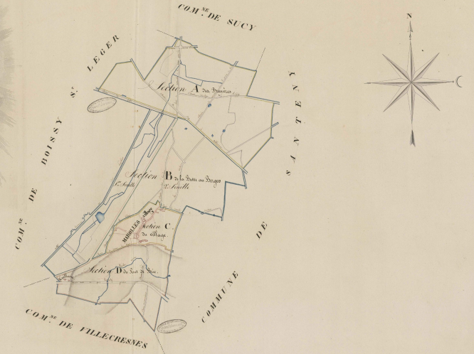
        <figcaption>Tableau d'assemblage de Marolles-en-Brie (1810).<br/>Source : Archives départementales du Val-de-Marne (94), 3P 1193.</figcaption>
    </figure>
</center>

:::

::: {.column width="50%"}
<center>
    <figure>
        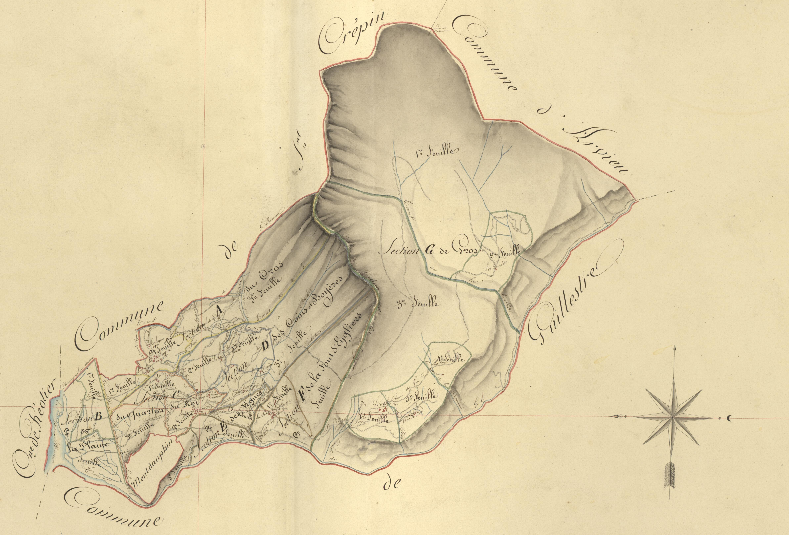
        <figcaption>Tableau d'assemblage d'Eygliers (1830).<br/>Source : Archives départementales des Hautes-Alpes (05), 3P 550.</figcaption>
    </figure>
</center>
:::
::::

## Présentation générale des documents

<center>
    <figure>
        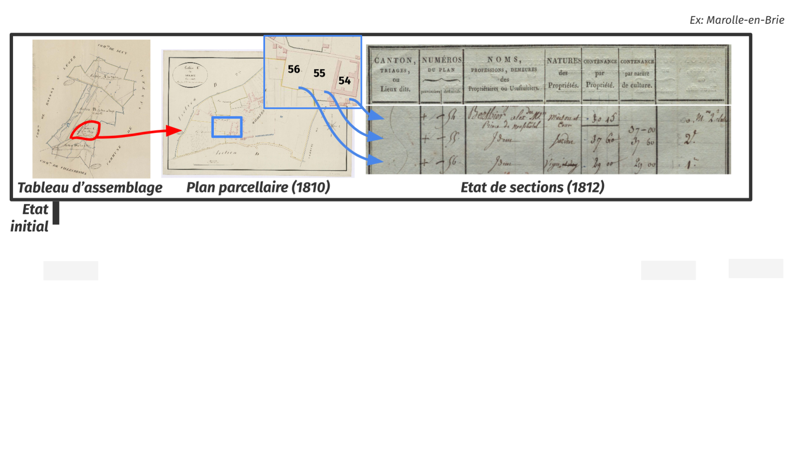
        <figcaption>Documents décrivant l'état initial du parcellaire. Source : AD94.</figcaption>
    </figure>
</center>

## Présentation générale des documents

<center>
    <figure>
        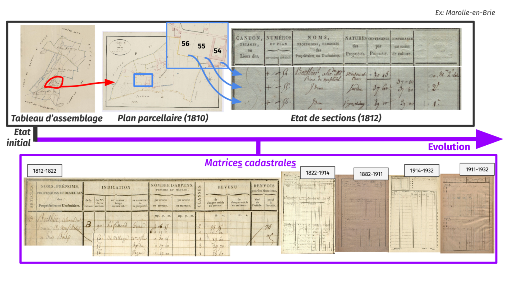
        <figcaption>L'évolution des informations sur le parcellaire (revenu, contribuable, ...) est consignée dans les matrices. Source : AD94.</figcaption>
    </figure>
</center>

## Reconstitution de l'évolution d'une parcelle

Exemple de la parcelle C-119 à Marolles-en-Brie (94).
<figure style="text-align:center">
    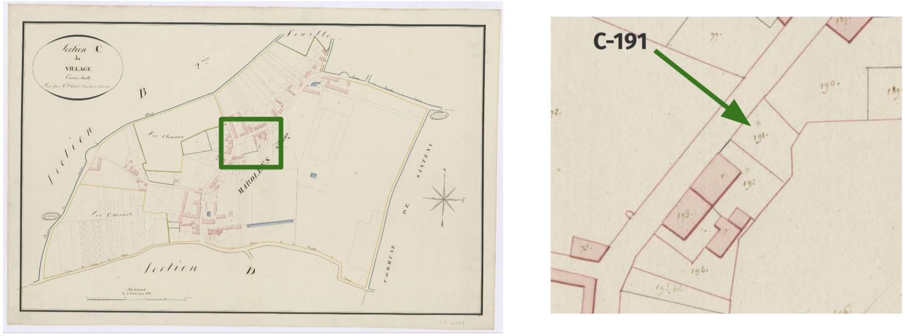
    <figcaption><br/>Source : Archives départementales du Val-de-Marne (94), 3P 1197.</figcaption>
</figure>


## Reconstitution de l'évolution d'une parcelle


<figure style="text-align:center">
    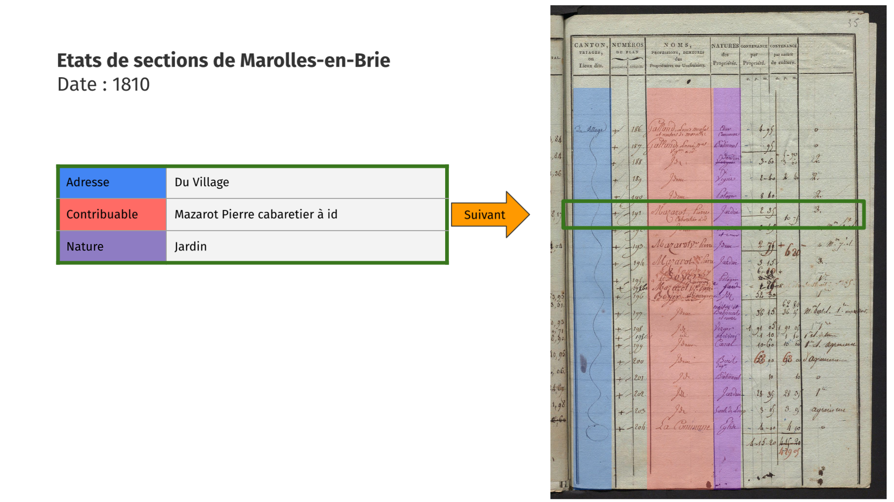
</figure>

## Reconstitution de l'évolution d'une parcelle

Évolution de la parcelle C-119 à Marolles-en-Brie
<figure>
    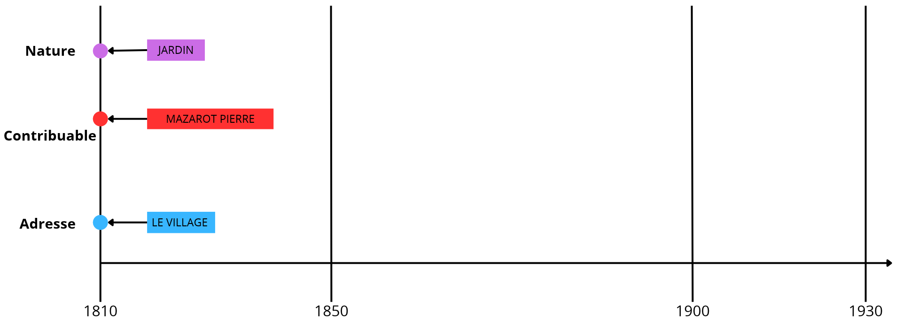
</figure>


## Reconstitution de l'évolution d'une parcelle

<figure style="text-align:center">
    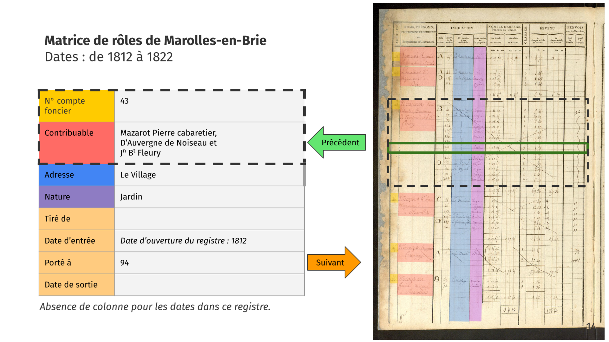
</figure>

## Reconstitution de l'évolution d'une parcelle

Évolution de la parcelle C-119 à Marolles-en-Brie
<figure style="text-align:center">
    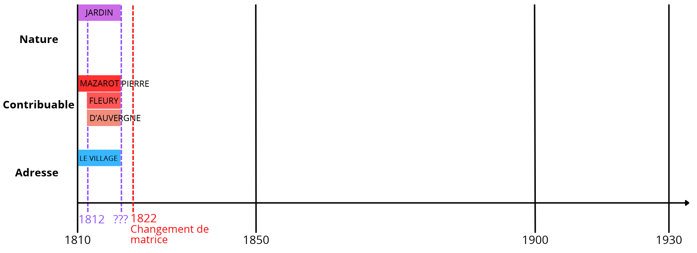
</figure>

## Reconstitution de l'évolution d'une parcelle

<figure style="text-align:center">
    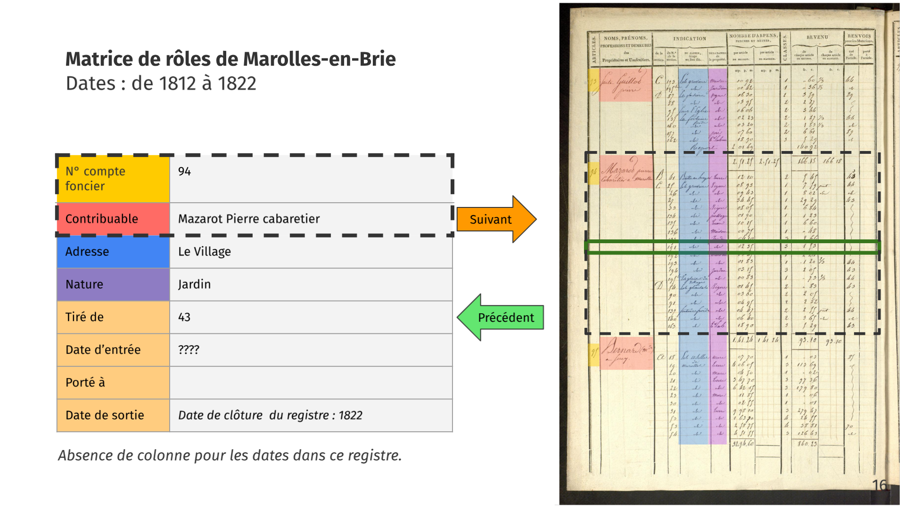
</figure>

## Reconstitution de l'évolution d'une parcelle
Évolution de la parcelle C-119 à Marolles-en-Brie

<figure style="text-align:center">
    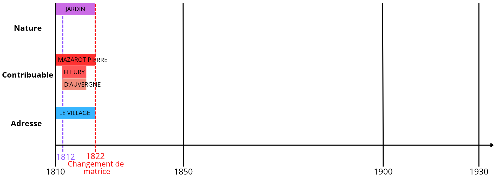
</figure>

## Reconstitution de l'évolution d'une parcelle

<figure style="text-align:center">
    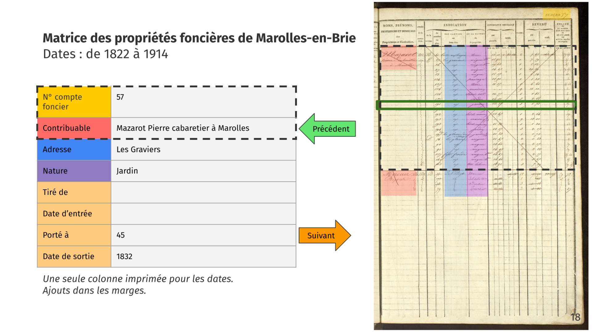
</figure>

## Reconstitution de l'évolution d'une parcelle
Évolution de la parcelle C-119 à Marolles-en-Brie

<figure style="text-align:center">
    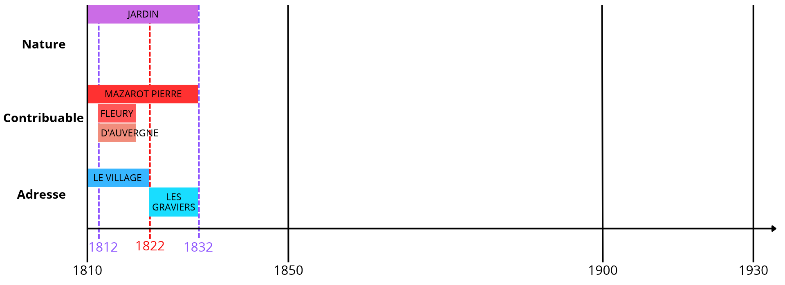
</figure>

## Reconstitution de l'évolution d'une parcelle

<figure style="text-align:center">
    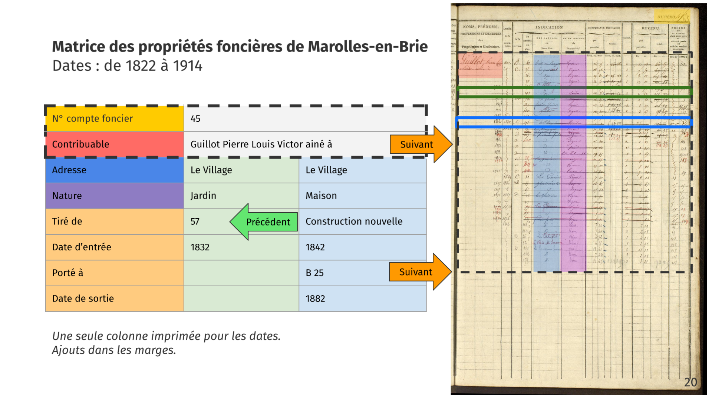
</figure>

## Reconstitution de l'évolution d'une parcelle

Évolution de la parcelle C-119 à Marolles-en-Brie
<figure style="text-align:center">
    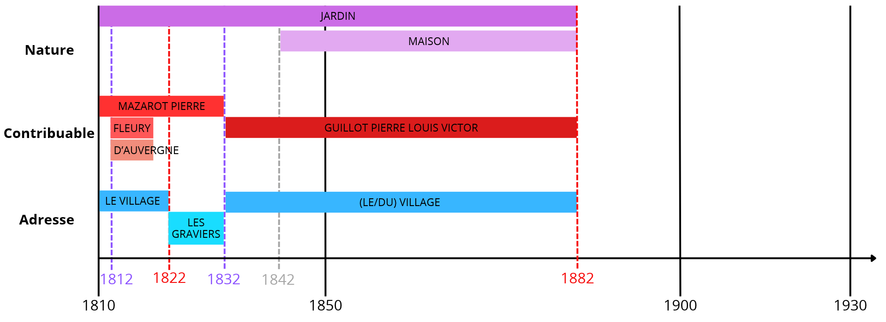
</figure>

## Reconstitution de l'évolution d'une parcelle

Toutes les matrices sont ainsi parcourues...

<figure style="text-align:center">
    
</figure>

## Reconstitution de l'évolution d'une parcelle

... pour aboutir à la reconstitution complète de l'historique de la parcelle, **attribut par attribut**.

<figure style="text-align:center">
    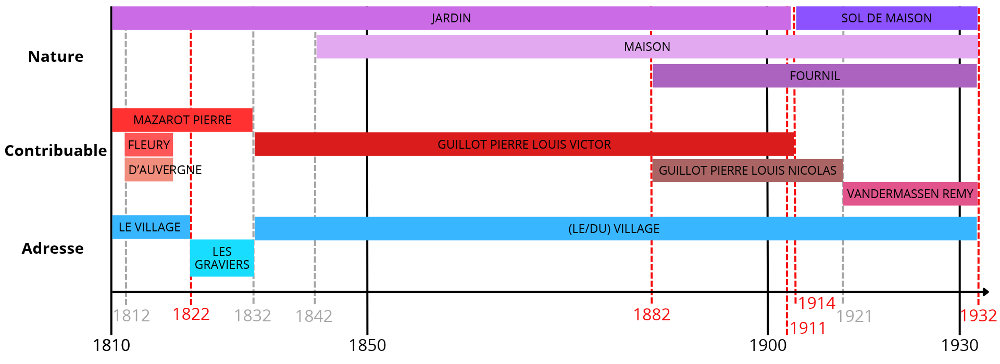
</figure>

## Questions de recherche

::: {.nonincremental}
1. Comment **représenter les connaissances sur les parcelles et leur évolution de façon homogène** à partir de documents hétérogènes ?

<figure style="text-align:center">
    
</figure>
:::

## Questions de recherche
::: {.nonincremental}
2. Quelle **méthode utiliser pour organiser des connaissances isolées sur chaque attribut de chaque parcelle suivant une logique spatio-temporelle adaptée** ? 
<center>
    <figure>
        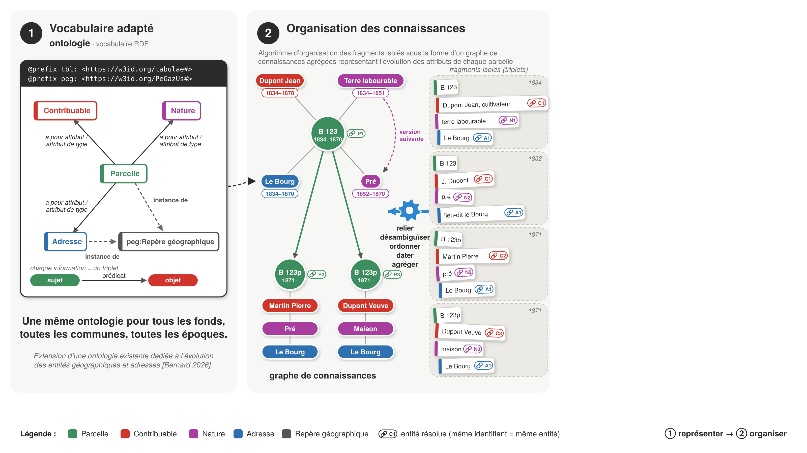
    </figure>
</center>
:::

## Questions de recherche
::: {.nonincremental}
3. Comment **extraire automatiquement les informations à partir des tables manuscrites** (au contenu et à la structure variables) ?
<center>
    <figure>
        
    </figure>
</center>
:::

## Zones d'étude
### Val-de-Marne (anciennement Seine et Seine-et-Oise)
:::: {.columns}
::: {.nonincremental .column width="60%"}
**L'Haÿ**

```{mermaid}
gantt
    dateFormat YYYY-MM-DD
    axisFormat %Y
    tickInterval 10year

    section Etat initial (c1)
    .                          :debut, 1800-01-01, 0d
    Plans parcellaires         :milestone, plan, 1811-01-01, 0d

    section Evolution (c1)
    M. des propriétés bâties et non bâties :mat1, 1814-01-01, 1841-06-30

    section Etat initial (c2)
    Plans parcellaires       :milestone, plan2, 1845-01-01, 0d
    Etats de sectionss          :milestone, etat2, 1842-01-01, 0d

    section Evolution (c2)
    M. des propriétés foncières (non bâties à partir de 1882) :mat2, 1841-07-01, 1914-12-31
    M. des propriétés non bâties                 :mat3, 1914-01-01, 1931-12-31
    M. des propriétés bâties                                  :mat4, 1882-01-01, 1910-12-31
    M. propriétés bâties                                  :mat5, 1911-01-01, 1931-12-31
```
:::

::: {.column width="40%"}
<figure style="text-align:center">
    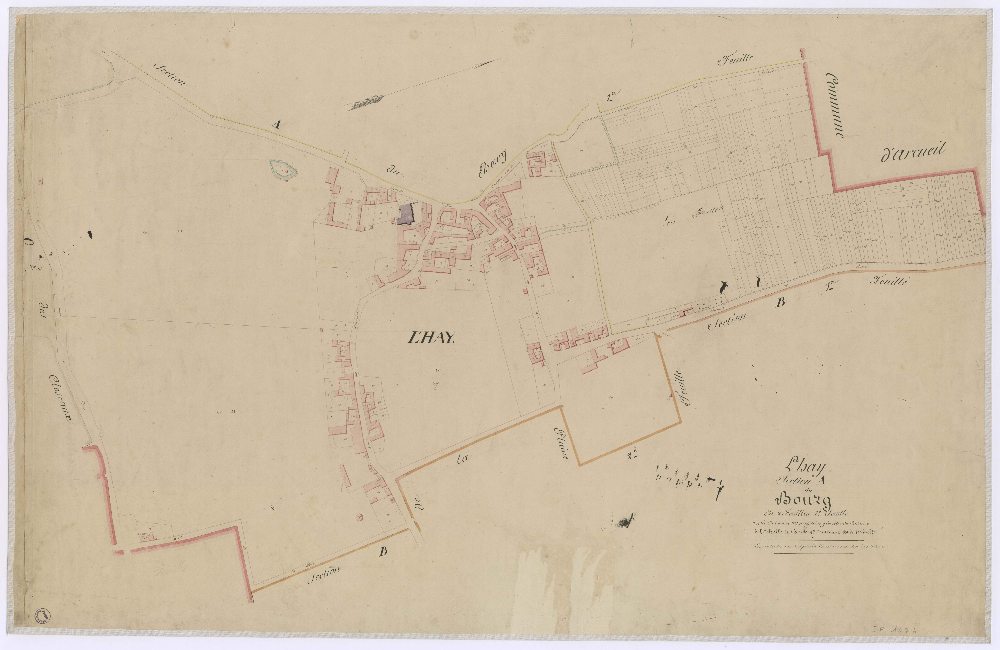
    <figcaption>Plan parcellaire de la section A de L'Haÿ (1845).<br/>Source : Archives départementales du Val-de-Marne (94), <br/>3P 1074.</figcaption>
</figure>
:::
::::

## Zones d'étude
### Val-de-Marne (anciennement Seine et Seine-et-Oise)
:::: {.columns}
::: {.nonincremental .column width="60%"}
**Gentilly**

```{mermaid}
gantt
    dateFormat YYYY-MM-DD
    axisFormat %Y
    tickInterval 10year

    section Etat initial (c1)
    .                          :debut, 1800-01-01, 0d
    Plans parcellaires         :milestone, plan, 1811-01-01, 0d

    section Evolution (c1)
    M. des propriétés bâties et non bâties :mat1, 1813-01-01, 1836-06-30

    section Etat initial (c2)
    Plans parcellaires       :milestone, plan2, 1845-01-01, 0d
    Etats de sectionss          :milestone, etat2, 1847-01-01, 0d

    section Evolution (c2)
    M. des propriétés foncières :mat2, 1836-07-01, 1848-06-30
    M. des propriétés foncières :mat3, 1848-07-01, 1860-12-31
    M. des propriétés foncières (non bâties à partir de 1882)      :mat4, 1861-01-01, 1913-12-31
    M. des propriétés bâties                              :mat5, 1882-01-01, 1910-12-31
    M. des propriétés bâties                                  :mat6, 1911-01-01, 1941-12-31
    M. des propriétés non bâties                                  :mat7, 1914-01-01, 1941-12-31
```
:::

::: {.column width="40%"}
<figure style="text-align:center">
    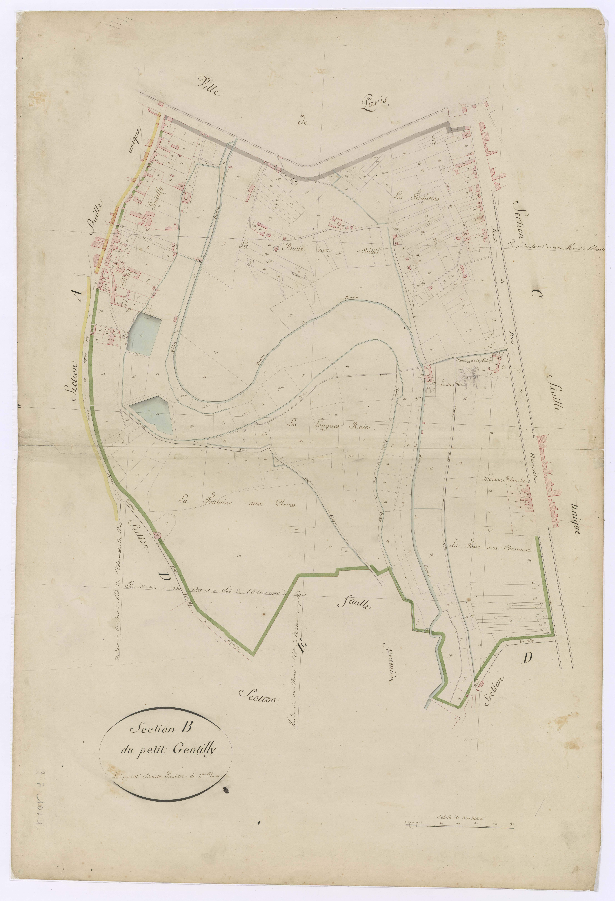
    <figcaption>Plan parcellaire de Gentilly, section B (1811).<br/>Source : Archives départementales du Val-de-Marne (94), <br/>3P 1041.</figcaption>
</figure>
:::
::::

## Zones d'étude
### Hautes-Alpes
:::: {.columns}

::: {.column width="60%" .nonincremental}
**Mont-Dauphin**

```{mermaid}
gantt
    dateFormat YYYY-MM-DD
    axisFormat %Y
    tickInterval 10year

    section Etat initial
    Plan parcellaire         :milestone, plan, 1830-01-01, 0d
    Etats de sections          :milestone, etat, 1830-01-01, 0d

    section Evolution
    Matrice des propriétés foncières (non bâties à partir de 1882) :mat1, 1830-01-01, 1911-12-31
    Matrice des propriétés bâties                                  :mat2, 1882-01-01, 1911-12-31
```
:::

::: {.column width="40%"}
<figure style="text-align:center">
    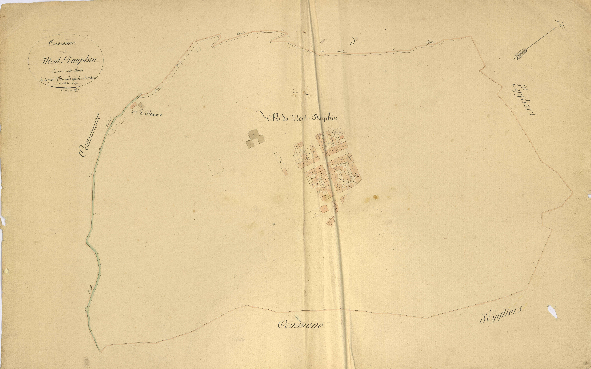
    <figcaption>Plan parcellaire de Mont-Dauphin, section unique (1830).<br/>Source : Archives départementales des Hautes-Alpes (05), <br/>3P 872.</figcaption>
</figure>
:::
::::

## Zones d'étude
### Finistère

:::: {.columns}
::: {.column width="60%" .nonincremental}
**Ouessant**

```{mermaid}
gantt
    dateFormat YYYY-MM-DD
    axisFormat %Y
    tickInterval 10year

    section Etat initial
    Plan parcellaire         :milestone, plan, 1842-11-04, 0d
    Etats de sectionss          :milestone, etat, 1844-01-01, 0d

    section Evolution
    Matrice des propriétés foncières (non bâties à partir de 1882) :mat1, 1844-01-01, 1914-06-30
    Matrice des propriétés bâties                                  :mat2, 1882-01-01, 1911-12-31
    Matrice des propriétés non bâties                              :mat3, 1911-01-01, 1973-12-31
    Matrice des propriétés bâties                                  :mat4, 1914-07-01, 1973-12-31
```
:::
::: {.column width="40%"}
<figure style="text-align:center">
    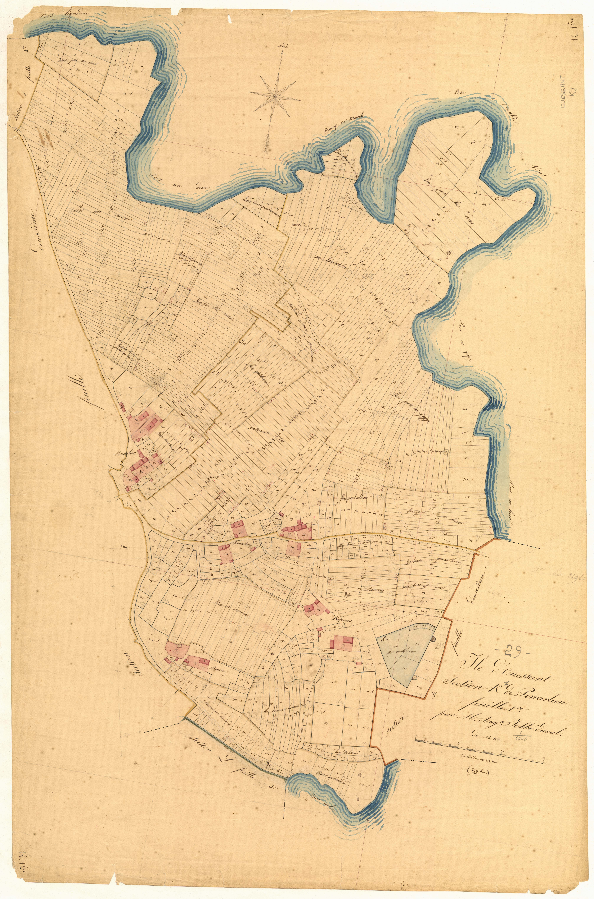
    <figcaption>Plan parcellaire d'Ouessant, section K, feuille 1 (1842).<br/>Source : Archives départementales du Finistère (29),<br/>3P 156 01 26.</figcaption>
</figure>
:::
::::