# II. L'ontologie TABULAE {data-short="II. Ontologie TABULAE"}
Un vocabulaire pour décrire l'évolution des parcelles à partir du corpus cadastral

## Méthode
::::{.columns}
::: {.column width="50%" .nonincremental}
**Au préalable :**

* Analyse des documents cadastraux (AD Val-de-Marne)
* Étude de l'histoire du cadastre à partir de travaux d'historiens (création, principales évolutions) (@clergeot_recueil_2021; @vivier_debats_2021)
* État de l'art des approches de représentation de l'évolution des entités géographiques (géomatique, web sémantique) (@kauppinen_creating_2008; @dumenieu_systeme_2015; @bernard_tsn_2017; @charles_hht_2023)

:::
::: {.column width="50%"}
<figure style="text-align:center">
    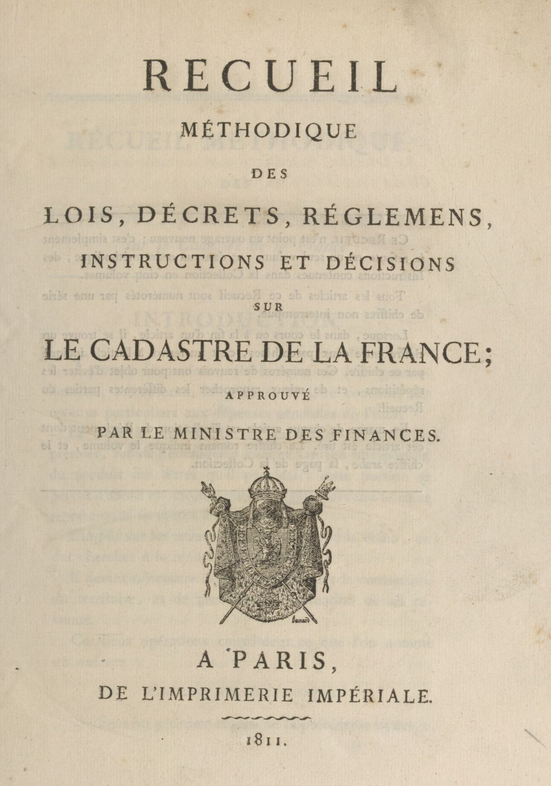
    <figcaption>Page de garde du <i>Recueil de 1810</i>. Source : <a href="https://gallica.bnf.fr/ark:/12148/bpt6k96475008#">Bibliothèque nationale de France</a></figcaption>
</figure>
:::
::::

## Méthode
::::{.columns}
::: {.column width="50%" .nonincremental}
**Mise en œuvre (@peroni_samod) :**

1. Rédaction d'une documentation illustrée d'exemples issus du cadastre ancien
2. Implémentation de l'ontologie dans un langage formel (OWL)
3. Validation de l'ontologie avec des cas d'usage concrets issus du cadastre ancien (Val-de-Marne)
:::
::: {.column width="50%"}
<figure style="text-align:center">
    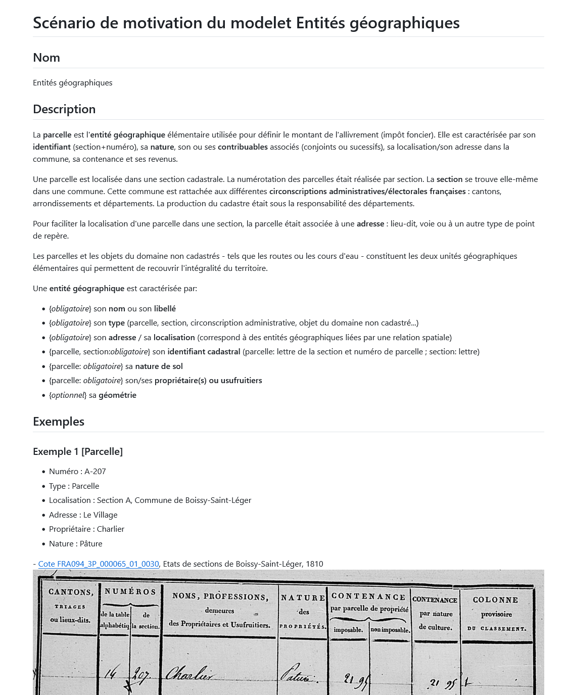
    <figcaption>Extrait de la documentation de l'ontologie TABULAE.<br/><a href="https://github.com/solenn-tl/tabulae-ontology">github.com/solenn-tl/tabulae-ontology</a></figcaption>
</figure>
:::
::::

## Repères géographiques et leur évolution

::::{.columns}
:::{.column width="50%" .nonincremental}
* Réutilisation et extension de l'**ontologie PeGazUs (@bernard_pegazus)** pour représenter les entités géographiques et leur évolution.

```{mermaid}
graph TD
    Landmark(["Entité géographique <br/> <small>peg:Landmark</small>"]):::class_
    TypeLandmark(["Type d’entité géographique<br/><small>peg:LandmarkType</small>"]):::skos
    Attribut(["Attribut<br/><small>peg:Attribute</small>"]):::class_
    TypeAttribut(["Type d’attribut<br/><small>peg:AttributeType</small>"]):::skos
    AttributVersion(["Version d’attribut<br/><small>peg:AttributeVersion</small>"]):::class_
    Value["Valeur<br/><small>Literal</small>"]:::literal

    Landmark -- "a pour attribut" --> Attribut
    Landmark -- "est un repère de type" --> TypeLandmark
    Attribut -- "est un attribut de type" --> TypeAttribut
    Attribut -- "a pour version" --> AttributVersion
    AttributVersion -- "a pour valeur" --> Value

    classDef class_ fill:#4FA1E0,stroke:#135385,stroke-width:3px;
    classDef skos fill:#f9f,stroke:#333,stroke-width:3px;
    classDef literal fill:#79BD8E,stroke:#17632F,stroke-width:3px;
```
:::

:::{.column width="50%" .nonincremental}
Extension :

* Ajout des types de repères propres au cadastre : parcelle, section, canton (ancien), arrondissement, commune, département.
* Ajout des types d'attributs propres au cadastre : contribuable, adresse associés à la parcelle, nature.
:::
::::

## Repères géographiques et leur évolution

Exemple : nature d'une parcelle.

```{mermaid}
graph TD
    Landmark(["C-119<br/> <small>peg:Landmark</small>"]):::class_
    TypeLandmark(["Parcelle<br/><small>peg:LandmarkType</small>"]):::skos
    Attribut(["Attribut<br/><small>peg:Attribute</small>"]):::class_
    TypeAttribut(["Nature de parcelle<br/><small>peg:AttributeType</small>"]):::skos
    AttributVersion(["Version d’attribut<br/><small>peg:AttributeVersion</small>"]):::class_
    Value(["Pré<br/><small>tbl:Nature</small>"]):::skos

    Landmark -- "a pour attribut" --> Attribut
    Landmark -- "est un repère de type" --> TypeLandmark
    Attribut -- "est un attribut de type" --> TypeAttribut
    Attribut -- "a pour version" --> AttributVersion
    AttributVersion -- "a pour nature" --> Value

    classDef class_ fill:#4FA1E0,stroke:#135385,stroke-width:3px;
    classDef skos fill:#f9f,stroke:#333,stroke-width:3px;
    classDef literal fill:#79BD8E,stroke:#17632F,stroke-width:3px;
```

## Repères géographiques et leur évolution

Exemple : évolution de la nature d'une parcelle.

::: {.mermaid-fit style="--h: 580px; --zoom: 1.2"}
```{mermaid}
graph TD
    Landmark(["C-119<br/> <small>peg:Landmark</small>"]):::class_
    TypeLandmark(["Parcelle<br/><small>peg:LandmarkType</small>"]):::skos
    Attribut(["Attribut<br/><small>peg:Attribute</small>"]):::class_
    TypeAttribut(["Nature de parcelle<br/><small>peg:AttributeType</small>"]):::skos
    AttributVersion(["Version d’attribut<br/><small>peg:AttributeVersion</small>"]):::class_
    Value(["Pré<br/><small>tbl:Nature</small>"]):::skos
    Change(["Changement<br/><small>peg:Change</small>"]):::class_
    AttributVersion2(["Version d’attribut<br/><small>peg:AttributeVersion</small>"]):::class_
    Value2(["Maison<br/><small>tbl:Nature</small>"]):::skos
    Evenement(["Évènement<br/><small>peg:Event</small>"]):::class_
    Date(["Date<br/><small>time:TimeInstant</small>"]):::class_
    DateInst["‘1836’"]:::literal

    Landmark -- "a pour attribut" --> Attribut
    Landmark -- "est un repère de type" --> TypeLandmark
    Attribut -- "est un attribut de type" --> TypeAttribut
    Attribut -- "a pour version" --> AttributVersion
    Attribut -- "a pour version" --> AttributVersion2
    AttributVersion -- "a pour nature" --> Value
    AttributVersion2 -- "a pour nature" --> Value2
    AttributVersion -- "avant" --> Change
    AttributVersion2 -- "après" --> Change
    Change -- "dépend de" --> Evenement
    Evenement -- "a pour valeur temporelle" --> Date
    Date -- "a pour timestamp" --> DateInst

    classDef class_ fill:#4FA1E0,stroke:#135385,stroke-width:3px;
    classDef skos fill:#f9f,stroke:#333,stroke-width:3px;
    classDef literal fill:#79BD8E,stroke:#17632F,stroke-width:3px;
```

:::

## Repères géographiques et leur évolution
<figure style="text-align:center">
    <figcaption>Taxonomie des natures de parcelles.</figcaption>
    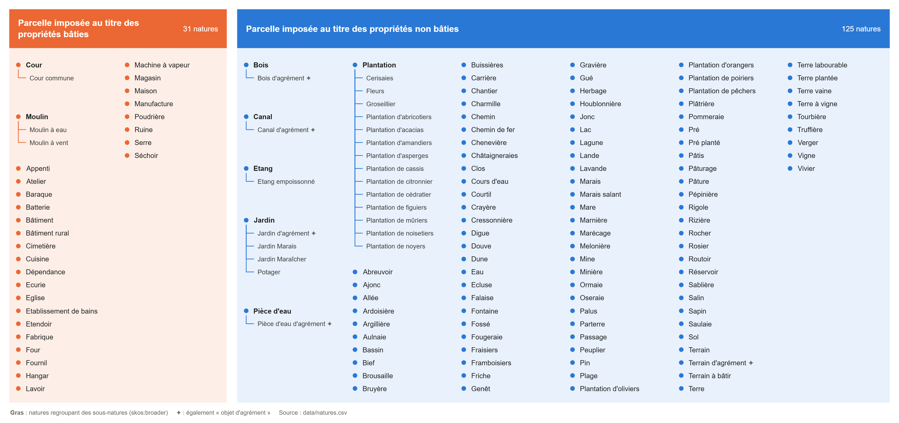
</figure>

## Contribuables
::::{.columns}
:::{.column width="50%" .nonincremental}
<figure>
    <figcaption>Berthoty Joseph Vve à Mont Dauphin<br/><em>Matrice des propriétés foncières, Mont-Dauphin. Source : AD05.</em></figcaption>
    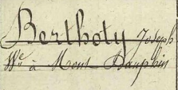
</figure>

<figure>
    <figcaption>Frézet Joseph fils Vincent à Mont Dauphin<br/><em>Matrice des propriétés bâties, Mont-Dauphin. Source : AD05.</em></figcaption>
    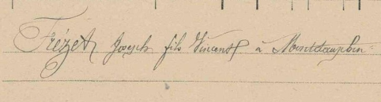
</figure>

<figure>
    <figcaption>Berthelé enf: Jn Mie Keranchas<br/><em>États de sections, Ouessant. Source : AD29.</em></figcaption>
    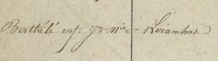
</figure>
:::

:::{.column width="50%" .nonincremental}
<figure>
    <figcaption>Berthier Alexandre Prince de neufchâtel à Gros Bois<br/><em>Matrice des propriétés bâties et non bâties, Marolles-en-Brie. Source : AD94.</em></figcaption>
    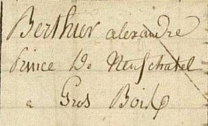
</figure>

<figure>
    <figcaption>La Commune de Marolles<br/><em>Matrice des propriétés bâties et non bâties, Marolles-en-Brie. Source : AD94.</em></figcaption>
    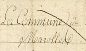
</figure>

<figure>
    <figcaption>Gaulin auguste époux Barrué 170 rue Michel Bizot à Paris<br/><em>Matrice des propriétés bâties, L'Haÿ. Source : AD94.</em></figcaption>
    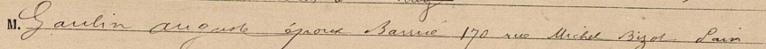
</figure>
:::
::::

## Contribuables

::: {.mermaid-fit style="--h: 580px; --zoom: 1.2"}
```{mermaid}
%%{init: {"flowchart": {"rankSpacing": 25, "nodeSpacing": 8}}}%%
graph LR
    Contribuable(["Contribuable<br/> <small>tbl:Taxpayer</small>"]):::class_
    Landmark(["Adresse de contribuable<br/><small>peg:Landmark</small>"]):::class_

    Label["Label de contribuable"]:::literal
    OrganizationName["Nom d’organisation"]:::literal
    LastName["Nom"]:::literal
    FirstNames["Prénom.s"]:::literal
    BirthName["Nom de naissance"]:::literal
    Activity["Profession / Activité"]:::literal
    Adresse["Adresse"]:::literal
    ChildrenFirstNames["Prénom.s d’un enfant"]:::literal
    SpouseFirstNames["Prénom.s du conjoint"]:::literal
    ParentFirstNames["Prénom.s d’un parent"]:::literal
    FamilyStatus["Statut familial"]:::literal
    Status["Statut de contribuable"]:::literal
    Titre["Titre de civilité ou noblesse"]:::literal
    
    %% Valeurs empilées verticalement, en quinconce :
    %% liens courts (-->) et longs (--->) en alternance = petit décalage horizontal
    Contribuable -- "label" --> Label
    Contribuable -- "nom" --> LastName
    Contribuable -- "nom de naissance" --> BirthName
    Contribuable -- "prénom.s" --> FirstNames 
    Contribuable -- "statut familial" --> FamilyStatus
    Contribuable -- "nom d’organisation" --> OrganizationName
    Contribuable -- "profession / activité" ---> Activity 
    Contribuable -- "adresse" ---> Adresse
    Contribuable -- "adresse (entité)" ---> Landmark
    Contribuable -- "prénom.s d’un enfant" ---> ChildrenFirstNames
    Contribuable -- "prénom.s du conjoint" ---> SpouseFirstNames
    Contribuable -- "prénom.s d’un parent" ---> ParentFirstNames

    Contribuable -- "statut" --> Status
    Contribuable -- "titre" --> Titre

    classDef class_ fill:#4FA1E0,stroke:#135385,stroke-width:3px;
    classDef skos fill:#f9f,stroke:#333,stroke-width:3px;
    classDef literal fill:#79BD8E,stroke:#17632F,stroke-width:3px;
```
:::

## Contribuables
:::: {.columns}
:::{.column width="40%" .nonincremental .center}
<figure>
    <figcaption>Lecoeur Joseph rue de Rouen 11 à Paris.<br/><em>Source : Matrice des propriétés foncières de Gentilly, AD94.</em></figcaption>
    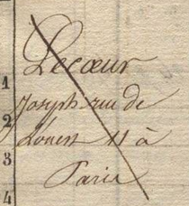
</figure>
:::

:::{.column width="60%" .nonincremental .mermaid-fit style="--h: 500px; --zoom: 1.2"}

```{mermaid}
graph LR
    Contribuable(["Lecoeur Joseph<br/> <small>tbl:Taxpayer</small>"]):::class_
    LastName["'Lecoeur' "]:::literal
    FirstNames["'Joseph' "]:::literal
    Address["'rue de Rouen 11 à Paris' "]:::literal

    Contribuable -- "nom" --> LastName
    Contribuable -- "prénom.s" --> FirstNames
    Contribuable -- "adresse" --> Address

    classDef class_ fill:#4FA1E0,stroke:#135385,stroke-width:3px;
    classDef skos fill:#f9f,stroke:#333,stroke-width:3px;
    classDef literal fill:#79BD8E,stroke:#17632F,stroke-width:3px;
```
:::
::::

## Contribuables
:::: {.columns}
:::{.column width="40%" .nonincremental .center}
<figure>
    <figcaption>Frézet Joseph fils Vincent à Mont Dauphin<br/><em>Matrice des propriétés bâties, Mont-Dauphin. Source : AD05.</em></figcaption>
    
</figure>
:::

:::{.column width="60%" .nonincremental .mermaid-fit style="--h: 450px; --zoom: 1.2"}

```{mermaid}
graph LR
    Contribuable(["Frézet Joseph<br/> <small>tbl:Taxpayer</small>"]):::class_
    LastName["'Frézet' "]:::literal
    FirstNames["'Joseph' "]:::literal
    Address["'Mont Dauphin' "]:::literal
    FamilyStatus["'fils' "]:::literal
    ParentFirstNames["'Vincent' "]:::literal

    Contribuable -- "nom" --> LastName
    Contribuable -- "prénom.s" --> FirstNames
    Contribuable -- "adresse" --> Address
    Contribuable -- "statut familial" --> FamilyStatus
    Contribuable -- "prénom.s d’un parent" --> ParentFirstNames

    classDef class_ fill:#4FA1E0,stroke:#135385,stroke-width:3px;
    classDef skos fill:#f9f,stroke:#333,stroke-width:3px;
    classDef literal fill:#79BD8E,stroke:#17632F,stroke-width:3px;
```
:::
::::

## Documents cadastraux et traçabilité des informations

Représentation des documents avec l'ontologie <em>Records in Context</em> (@rico) : état de sections.

:::: {.columns}

:::{.column width="50%" .nonincremental}
<figure style="text-align:center">
    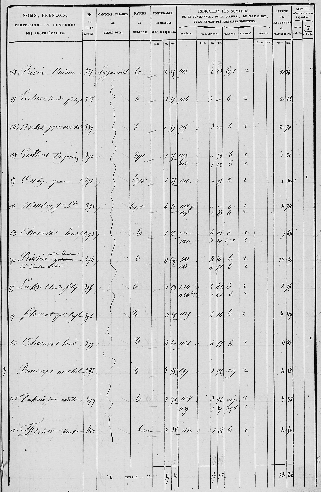
        <figcaption>État de sections de L'Haÿ, 3P 275 vue 100. Source : AD94</figcaption>
</figure>
:::

:::{.column width="50%" .nonincremental .mermaid-fit style="--h: 550px; --zoom: 1.2"}

```{mermaid}
graph TD
    Registre(["Registre<br/> <small>rico:Instantiation</small>"]):::class_
    Page(["Page<br/><small>rico:Instantiation</small>"]):::class_
    Ligne(["Ligne<br/><small>rico:Instantiation</small>"]):::class_
    TranscriptionLigne["Transcription"]:::literal
    OrdreLigne["Rang dans page"]:::literal

    Registre -- "a ou a eu pour composant" --> Page
    Page -- "a ou a eu pour composant" --> Ligne
    Ligne -- "rang dans doc. parent" --> OrdreLigne

    Ligne -- "transcription" --> TranscriptionLigne

    classDef class_ fill:#4FA1E0,stroke:#135385,stroke-width:3px;
    classDef skos fill:#f9f,stroke:#333,stroke-width:3px;
    classDef literal fill:#79BD8E,stroke:#17632F,stroke-width:3px;
```

:::

::::

## Documents cadastraux et traçabilité des informations
Traçabilité des informations (@provo).

:::{.nonincremental .mermaid-fit style="--h: 550px; --zoom: 1.2"}
```{mermaid}
graph TD
    Registre(["Registre<br/> <small>rico:Instantiation</small>"]):::class_
    Page(["Page<br/><small>rico:Instantiation</small>"]):::class_
    Ligne(["Ligne<br/><small>rico:Instantiation</small>"]):::class_
    TranscriptionLigne["Transcription"]:::literal
    OrdreLigne["Rang dans page"]:::literal

    Landmark(["Entité géographique<br/> <small>peg:Landmark</small>"]):::class_
    LandmarkType(["Parcelle<br/><small>peg:LandmarkType</small>"]):::skos

    Registre -- "a ou a eu pour composant" --> Page
    Page -- "a ou a eu pour composant" --> Ligne
    Ligne -- "rang dans doc. parent" --> OrdreLigne

    Ligne -- "transcription" --> TranscriptionLigne

    Landmark -- "est un repère de type" --> LandmarkType

    Landmark -- "dérivé de" --> Ligne

    classDef class_ fill:#4FA1E0,stroke:#135385,stroke-width:3px;
    classDef skos fill:#f9f,stroke:#333,stroke-width:3px;
    classDef literal fill:#79BD8E,stroke:#17632F,stroke-width:3px;
```
:::

## Documents cadastraux et traçabilité des informations
<figure style="text-align:center">
    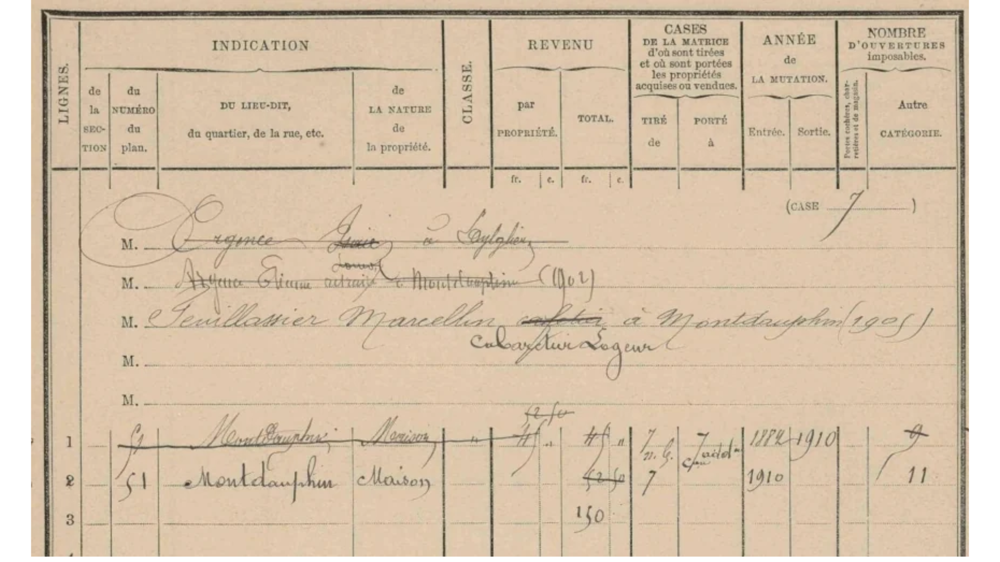
    <figcaption>Matrice des propriétés bâties de Mont-Dauphin, 3P 874 vue 8. Source : AD05</figcaption>
</figure>

## Documents cadastraux et traçabilité des informations
<figure style="text-align:center">
    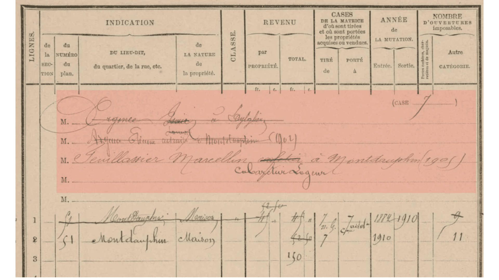
    <figcaption>Matrice des propriétés bâties de Mont-Dauphin, 3P 874 vue 8. Source : AD05</figcaption>
</figure>

## Documents cadastraux et traçabilité des informations
<figure style="text-align:center">
    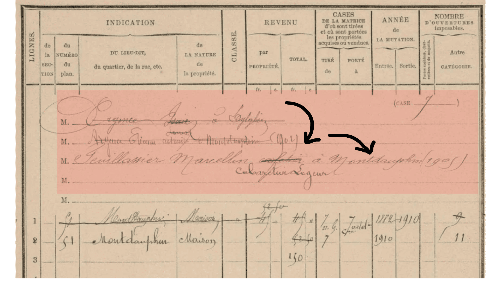
    <figcaption>Matrice des propriétés bâties de Mont-Dauphin, 3P 874 vue 8. Source : AD05</figcaption>
</figure>

## Documents cadastraux et traçabilité des informations
<figure style="text-align:center">
    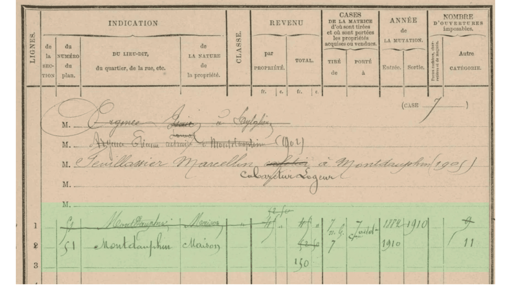
    <figcaption>Matrice des propriétés bâties de Mont-Dauphin, 3P 874 vue 8. Source : AD05</figcaption>
</figure>

## Documents cadastraux et traçabilité des informations
<figure style="text-align:center">
    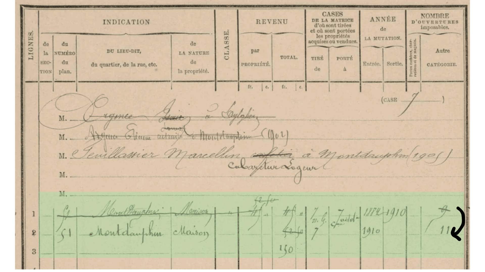
    <figcaption>Matrice des propriétés bâties de Mont-Dauphin, 3P 874 vue 8. Source : AD05</figcaption>
</figure>

## Documents cadastraux et traçabilité des informations
Représentation des documents avec l'ontologie <em>Records in Context</em> (@rico) : matrice.

:::{.mermaid-fit style="--h: 550px; --zoom: 1.2"}
```{mermaid}
graph TD
    Registre(["Registre<br/> <small>rico:Instantiation</small>"]):::class_
    Page(["Page<br/><small>rico:Instantiation</small>"]):::class_
    Folio(["Folio<br/><small>rico:Instantiation</small>"]):::class_
    CompteFoncier(["Compte foncier<br/><small>rico:Instantiation</small>"]):::class_
    ZoneContribuable(["Énoncé de contribuable<br/><small>rico:Instantiation</small>"]):::class_
    Ligne(["Ligne<br/><small>rico:Instantiation</small>"]):::class_
    TranscriptionContribuable["Transcription"]:::literal
    TranscriptionLigne["Transcription"]:::literal
    NumeroFolio["Numéro de folio"]:::literal
    OrdreCF["Rang dans le folio"]:::literal
    OrdreContribuable["Rang dans compte foncier"]:::literal
    OrdreLigne["Rang dans compte foncier"]:::literal

    Registre -- "a ou a eu pour composant" --> Page
    Page -- "a ou a eu pour composant" --> Folio
    Folio -- "a ou a eu pour composant" --> CompteFoncier
    CompteFoncier -- "a ou a eu pour composant" --> ZoneContribuable
    CompteFoncier -- "a ou a eu pour composant" --> Ligne

    Folio -- "a pour numéro de folio" --> NumeroFolio
    CompteFoncier -- "rang dans doc. parent" --> OrdreCF
    ZoneContribuable -- "rang dans doc. parent" -->  OrdreContribuable
    Ligne -- "rang dans doc. parent" --> OrdreLigne

    Ligne -- "transcription" --> TranscriptionLigne
    ZoneContribuable -- "transcription" --> TranscriptionContribuable


    classDef class_ fill:#4FA1E0,stroke:#135385,stroke-width:3px;
    classDef skos fill:#f9f,stroke:#333,stroke-width:3px;
    classDef literal fill:#79BD8E,stroke:#17632F,stroke-width:3px;
```
:::

## Documents cadastraux et traçabilité des informations
Changements de folios et de comptes fonciers.

::: {.mermaid-fit style="--h: 550px; --zoom: 1.2"}

```{mermaid}
graph TD
    Landmark(["A-51<br/> <small>peg:Landmark</small>"]):::class_
    TypeLandmark(["Parcelle<br/><small>peg:LandmarkType</small>"]):::skos
    Attribut(["Attribut<br/><small>peg:Attribute</small>"]):::class_
    TypeAttribut(["Mention d’une parcelle<br/><small>peg:AttributeType</small>"]):::skos
    AttributVersion(["Version d’attribut<br/><small>peg:AttributeVersion</small>"]):::class_
    
    Folio1(["Folio 7, M. des prop. bâties<br/><small>rico:Instantiation</small>"]):::class_
    Folio2(["Folio 7, M. des prop. foncières<br/><small>rico:Instantiation</small>"]):::class_
    Ligne(["Ligne<br/><small>rico:Instantiation</small>"]):::class_

    Change1(["Changement<br/><small>peg:Change</small>"]):::class_
    Change2(["Changement<br/><small>peg:Change</small>"]):::class_
    Event1(["Évènement<br/><small>peg:Event</small>"]):::class_
    Event2(["Évènement<br/><small>peg:Event</small>"]):::class_
    Date1(["Date<br/><small>time:TimeInstant</small>"]):::class_
    Date2(["Date<br/><small>time:TimeInstant</small>"]):::class_
    DateValue1["‘1882’"]:::literal
    DateValue2["‘1910’"]:::literal
    TypeEvent1(["Ouverture de la matrice<br/><small>tbl:EventType</small>"]):::skos
    TypeEvent2(["Clôture de la matrice<br/><small>tbl:EventType</small>"]):::skos

    Landmark -- "a pour attribut" --> Attribut
    Landmark -- "est un repère de type" --> TypeLandmark
    Attribut -- "est un attribut de type" --> TypeAttribut
    Attribut -- "a pour version" --> AttributVersion
    Ligne -- "est un composant de" --> Folio1
    AttributVersion -- "mentionné dans" --> Folio1
    AttributVersion -- "tiré de" --> Folio2
    AttributVersion -- "est rendu effectif par" --> Change1
    Change1 -- "dépend de" --> Event1
    Event1 -- "a pour valeur temporelle" --> Date1
    Date1 -- "a pour timestamp" --> DateValue1
    Event1 -- "a pour type d’évènement" --> TypeEvent1

    AttributVersion -- "est rendu caduc par" --> Change2
    Change2 -- "dépend de" --> Event2
    Event2 -- "a pour valeur temporelle" --> Date2
    Date2 -- "a pour timestamp" --> DateValue2
    Event2 -- "a pour type d’évènement" --> TypeEvent2

    classDef class_ fill:#4FA1E0,stroke:#135385,stroke-width:3px;
    classDef skos fill:#f9f,stroke:#333,stroke-width:3px;
    classDef literal fill:#79BD8E,stroke:#17632F,stroke-width:3px;
```

:::

## Documents cadastraux et traçabilité des informations
Valeurs spéciales renseignées dans certaines colonnes (notamment les colonnes dédiées aux reports de folios).

<figure style="text-align:center">
    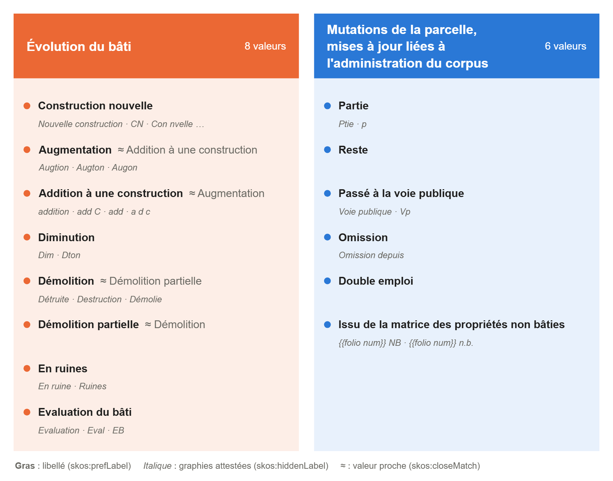
</figure>

## Questions de recherche
::: {.nonincremental}
1. Comment **représenter les connaissances sur les parcelles et leur évolution de façon homogène** à partir de documents hétérogènes ? ✅
<center>
    <figure>
        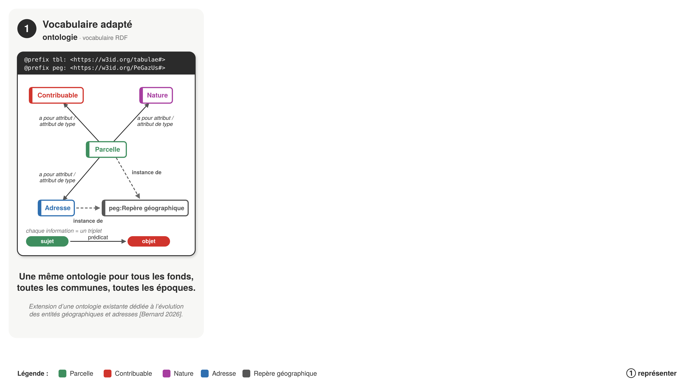
    </figure>
</center>
:::

## Questions de recherche
::: {.nonincremental}
2. Quelle **méthode utiliser pour organiser des connaissances isolées sur chaque attribut de chaque parcelle suivant une logique spatio-temporelle adaptée** ? 
<center>
    <figure>
        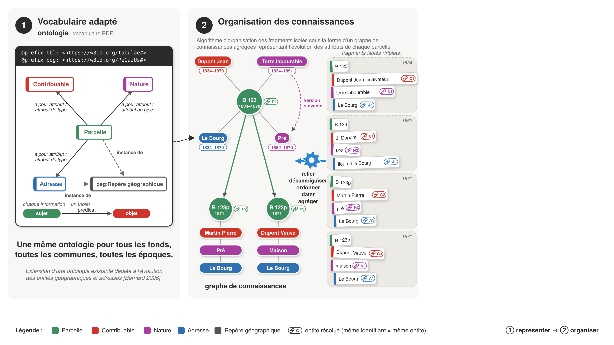
    </figure>
</center>
:::