# III. Reconstitution de l'évolution des parcelles {data-short="III. Évolution des entités"}
Algorithme de peuplement des ontologies PeGazUs et TABULAE

## Point de départ

:::{.nonincremental}
* Vocabulaire pour décrire les parcelles, les documents et les évolutions
* Fragments d'informations sur les parcelles et leur évolution disséminés dans les documents
:::

<br/>

### Objectif

:::{.nonincremental}
Organiser les fragments d'informations désordonnés et potentiellement ambigus d'entités géographiques, extraits de sources hétérogènes.
:::

<br/>

### Postulat
:::{.nonincremental}
On dispose de fragments d'informations transcrits et structurés.
:::

## Exemple : le quartier de la Butte-aux-Cailles

:::{.nonincremental}
* Création du premier cadastre de Gentilly en 1811
* Création d'un second cadastre vers 1845-1848
* Annexion du nord de la commune de Gentilly à Paris en 1860
:::

<center>
<figure>
    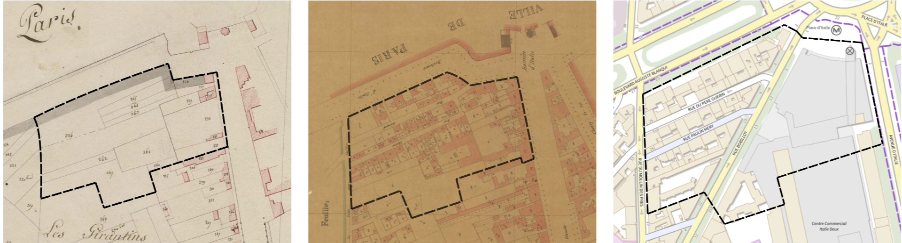
    <figcaption>Quartier de la Butte-aux-Cailles sur les plans parcellaires de 1811 (AD94), 1845 (AD75) et sur le plan IGN de 2025.</figcaption>
</figure>
</center>

## Documents utilisés

::: {.nonincremental}
* États de sections du quartier indisponibles pour les deux cadastres
* 3 matrices parcourues manuellement : 3 238 pages, extraction de 442 lignes (structure normalisée)
:::

::::{.columns}

:::{.column width="33%"}
<center>
<figure>
    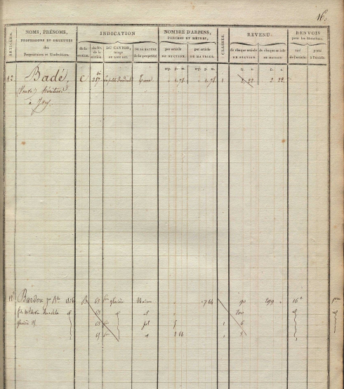
    <figcaption>Matrice des propriétés bâties et non bâties (1813-1836). Source : AD94.</figcaption>
</figure>
</center>
:::

:::{.column width="33%"}
<center>
<figure>
    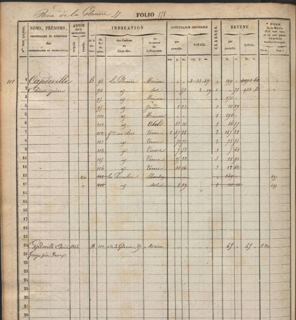
    <figcaption>Matrice des propriétés foncières (1836-1848). Source : AD94.</figcaption>
</figure>
</center>
:::

:::{.column width="33%"}
<center>
<figure>
    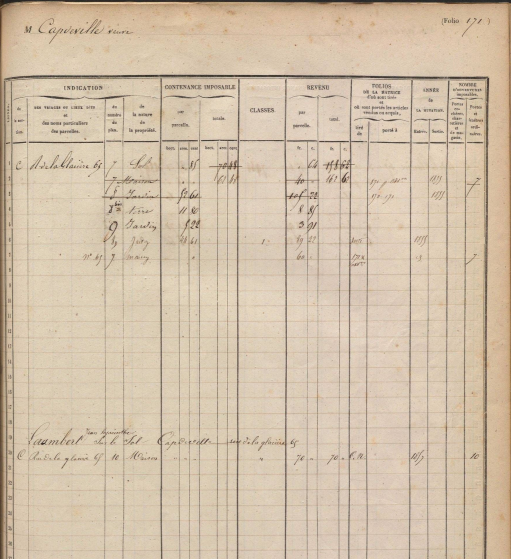
    <figcaption>Matrice des propriétés foncières du second cadastre (1848-1860). Source : AD94.</figcaption>
</figure>
</center>
:::

::::

## Données utilisées

<center>
Transcription diplomatique des tables.
<figure>
    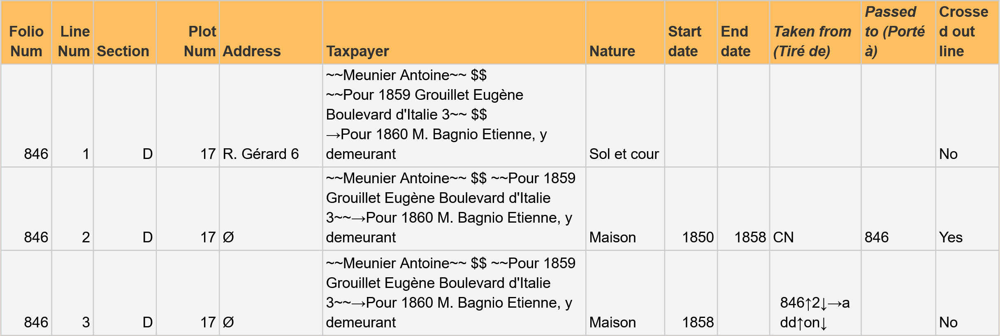
</figure>
</center>

## Données utilisées

<center>
Connaissances structurées selon l'ontologie TABULAE.
<figure>
    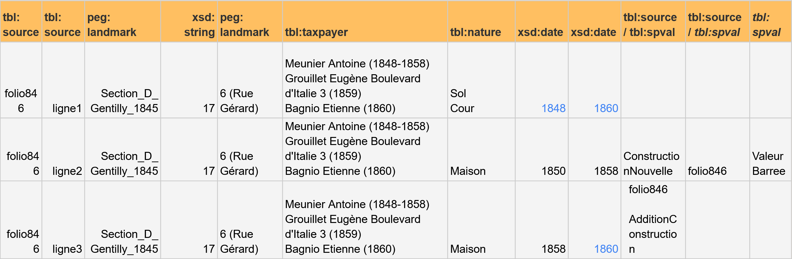
</figure>
</center>

## Algorithme de peuplement

### Ambiguïté des numéros de parcelles
<br/>

::: {.nonincremental}
* Les plans parcellaires **n'étaient pas mis à jour après leur création**.
    * Les parcelles issues de la **division d'une parcelle** du plan **héritent du numéro de la parcelle d'origine**.
    * Les parcelles issues de la **fusion de plusieurs parcelles portent un numéro composé des numéros des parcelles d'origine**.
        * Cas complexe : *fusion de parcelles issues de la division d'une même parcelle initiale*.
:::

<br/>

## Algorithme de peuplement

**Étape 1 : regroupement des mentions de parcelles par numéro**

:::{.nonincremental}
* **Racines** (en bleu) : parcelles sur le plan / dans l'état de sections
* **Mentions** (en blanc) : états des parcelles dans les matrices
:::

::: {.mermaid-fit style="--h: 400px; --zoom: 1.4"}
```{mermaid}
graph TB
    Root17(["D-17"]):::root
    Root18(["D-18"]):::root
    Root19(["D-19"]):::root

    Mention17_1(["D-17"]):::mention -- "a pour racine" --> Root17
    Mention17_2(["D-17"]):::mention -- "a pour racine" --> Root17
    Mention17_3(["D-17"]):::mention -- "a pour racine" --> Root17
    Mention18_1(["D-18"]):::mention -- "a pour racine" --> Root18
    Mention18_2(["D-18"]):::mention -- "a pour racine" --> Root18
    Mention19_1(["D-19p"]):::mention -- "a pour racine" --> Root19
    Mention19_2(["D-19"]):::mention -- "a pour racine" --> Root19

    classDef root fill:#4FA1E0,stroke:#135385,stroke-width:3px;
    classDef mention fill:#F2F2F2,stroke:#135385,stroke-width:3px;
```
:::

## Algorithme de peuplement

**Étape 2 : ordonnancement temporel des mentions de parcelles**
<center>
<figure>
    <figcaption>Ici, chaque ligne (bleue ou noire) correspond à la période de validité d'une ligne de table cadastrale décrivant une parcelle.</figcaption>
    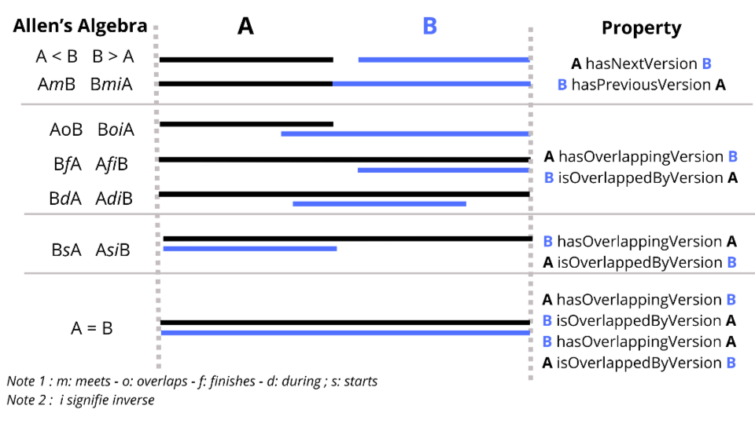
</figure>
</center>

## Algorithme de peuplement

:::{.nonincremental}
**Étape 3 : déduction des divisions et fusions de parcelles**

* **Division** : une parcelle est divisée si elle est **portée à** plusieurs folios.
* **Fusion** : plusieurs parcelles sont fusionnées si elles **portent un numéro de parcelle composé**.
:::

<center>
<figure>
    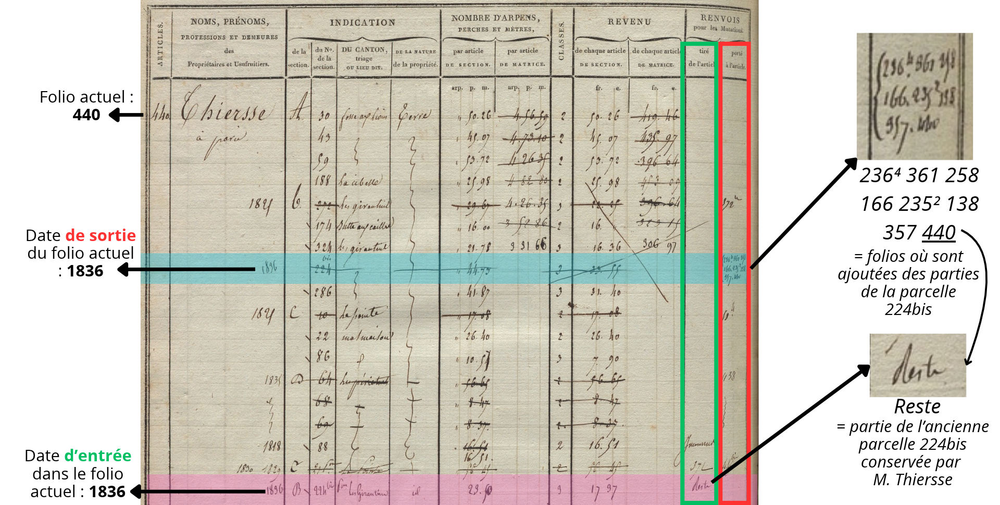
    <figcaption>Folio 440 de la matrice des propriétés bâties et non bâties de Gentilly (1813-1836). Source : AD94.</figcaption>
</figure>
</center>

## Algorithme de peuplement

**Étape 3 : déduction des divisions et fusions de parcelles**

::: {.mermaid-fit style="--h: 650px; --zoom: 1.3"}
```{mermaid}
graph TD
    Landmark(["B-224bis<br/> <small>peg:Landmark</small>"]):::class_
    TypeLandmark(["Parcelle<br/><small>peg:LandmarkType</small>"]):::skos
    Attribut(["Attribut<br/><small>peg:Attribute</small>"]):::class_
    TypeAttribut(["Mention d’une parcelle<br/><small>peg:AttributeType</small>"]):::skos
    AttributVersion(["Version d’attribut<br/><small>peg:AttributeVersion</small>"]):::class_

    Folio1(["<b>Folio 440</b><br/><small>rico:Instantiation</small>"]):::class_
    Folio2(["<b>Folio 357</b><br/><small>rico:Instantiation</small>"]):::class_
    Folio3(["<b>Folio 138</b><br/><small>rico:Instantiation</small>"]):::class_
    Folio4(["<b>Folio 235</b><br/><small>rico:Instantiation</small>"]):::class_
    Folio5(["<b>Folio 166</b><br/><small>rico:Instantiation</small>"]):::class_
    Folio6(["<b>Folio 258</b><br/><small>rico:Instantiation</small>"]):::class_
    Folio7(["<b>Folio 361</b><br/><small>rico:Instantiation</small>"]):::class_
    Folio8(["<b>Folio 236</b><br/><small>rico:Instantiation</small>"]):::class_
    Ligne(["Ligne<br/><small>rico:Instantiation</small>"]):::class_

    Change1(["Changement<br/><small>peg:Change</small>"]):::class_
    Change2(["Changement<br/><small>peg:Change</small>"]):::class_
    Event1(["Évènement<br/><small>peg:Event</small>"]):::class_
    Event2(["Évènement<br/><small>peg:Event</small>"]):::class_
    Date1(["Date<br/><small>time:TimeInstant</small>"]):::class_
    Date2(["Date<br/><small>time:TimeInstant</small>"]):::class_
    DateValue1["‘1813’"]:::literal
    DateValue2["‘1836’"]:::literal
    TypeEvent1(["Ouverture de la matrice<br/><small>tbl:EventType</small>"]):::skos
    TypeEvent2(["Division de parcelle<br/><small>tbl:EventType</small>"]):::skos

    Landmark -- "est dérivé de" --> Ligne
    Ligne -- "est un composant de" --> Folio1
    Landmark -- "a pour attribut" --> Attribut
    Landmark -- "est un repère de type" --> TypeLandmark
    Attribut -- "est un attribut de type" --> TypeAttribut
    Attribut -- "a pour version" --> AttributVersion
    AttributVersion -- "mentionné dans" --> Folio1
    AttributVersion -- "passé à" --> Folio1
    AttributVersion -- "passé à" --> Folio2
    AttributVersion -- "passé à" --> Folio3
    AttributVersion -- "passé à" --> Folio4
    AttributVersion -- "passé à" --> Folio5
    AttributVersion -- "passé à" --> Folio6
    AttributVersion -- "passé à" --> Folio7
    AttributVersion -- "passé à" --> Folio8
    AttributVersion -- "est rendu effectif par" --> Change1
    Change1 -- "dépend de" --> Event1
    Event1 -- "a pour valeur temporelle" --> Date1
    Date1 -- "a pour timestamp" --> DateValue1
    Event1 -- "a pour type d’évènement" --> TypeEvent1

    AttributVersion -- "est rendu caduc par" --> Change2
    Change2 -- "dépend de" --> Event2
    Event2 -- "a pour valeur temporelle" --> Date2
    Date2 -- "a pour timestamp" --> DateValue2
    Event2 -- "a pour type d’évènement" --> TypeEvent2

    classDef class_ fill:#4FA1E0,stroke:#135385,stroke-width:3px;
    classDef skos fill:#f9f,stroke:#333,stroke-width:3px;
    classDef literal fill:#79BD8E,stroke:#17632F,stroke-width:3px;
```
:::

## Algorithme de peuplement

**Étape 4 : désambiguïsation des mentions de parcelles**

:::{.nonincremental}
* **Racines** (en <span style="color: blue;">**bleu**</span>) : parcelles sur le plan / dans l'état de sections
* **Mentions** (en **blanc**) : états des parcelles dans les matrices
* **Entités géographiques uniques** (en <span style="color: green;">**vert**</span>) : états de parcelles désignant *a priori* la même parcelle (même périmètre)
:::

::: {.mermaid-fit style="--h: 400px; --zoom: 1.4"}
```{mermaid}
graph TB
    Root17(["D-17"]):::root
    Root18(["D-18"]):::root
    Root19(["D-19"]):::root

    Mention17_1(["D-17"]):::mention -- "a pour racine" --> Root17
    Mention17_2(["D-17"]):::mention -- "a pour racine" --> Root17
    Mention17_3(["D-17"]):::mention -- "a pour racine" --> Root17
    Mention18_1(["D-18"]):::mention -- "a pour racine" --> Root18
    Mention18_2(["D-18"]):::mention -- "a pour racine" --> Root18
    Mention19_1(["D-19p"]):::mention -- "a pour racine" --> Root19
    Mention19_2(["D-19"]):::mention -- "a pour racine" --> Root19

    Landmark17_1(["D-17 (1)"]):::landmark -- "a pour trace" --> Mention17_1
    Landmark17_1(["D-17 (1)"]):::landmark -- "a pour trace" --> Mention17_2
    Landmark17_2(["D-17 (2)"]):::landmark -- "a pour trace" --> Mention17_3
    Landmark18(["D-18 (1)"]):::landmark -- "a pour trace" --> Mention18_1
    Landmark18(["D-18 (1)"]):::landmark -- "a pour trace" --> Mention18_2
    Landmark19(["D-19 (1)"]):::landmark -- "a pour trace" --> Mention19_1
    Landmark19_2(["D-19 (2)"]):::landmark -- "a pour trace" --> Mention19_2

    classDef root fill:#4FA1E0,stroke:#135385,stroke-width:3px;
    classDef mention fill:#F2F2F2,stroke:#135385,stroke-width:3px;
    classDef landmark fill:#79BD8E,stroke:#17632F,stroke-width:3px;
```
:::

## Algorithme de peuplement

**Étapes 5 et 6 : fusion des valeurs d'attributs successives de même valeur**

<figure style="text-align: center;">
    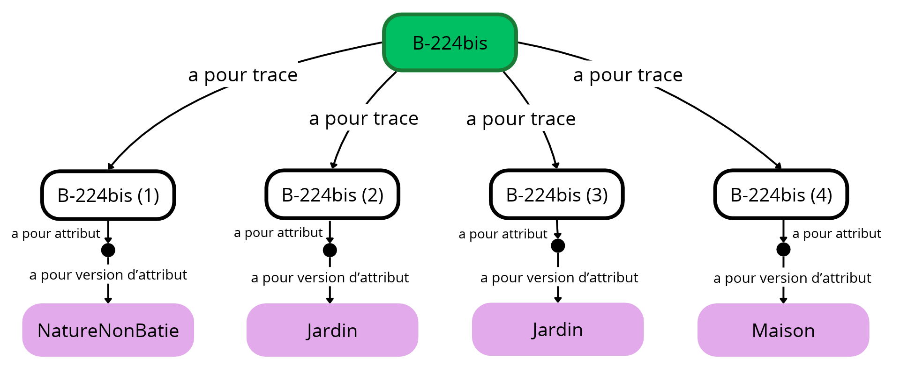
</figure>

## Algorithme de peuplement

**Étapes 5 et 6 : fusion des valeurs d'attributs successives de même valeur**

<figure style="text-align: center;">
    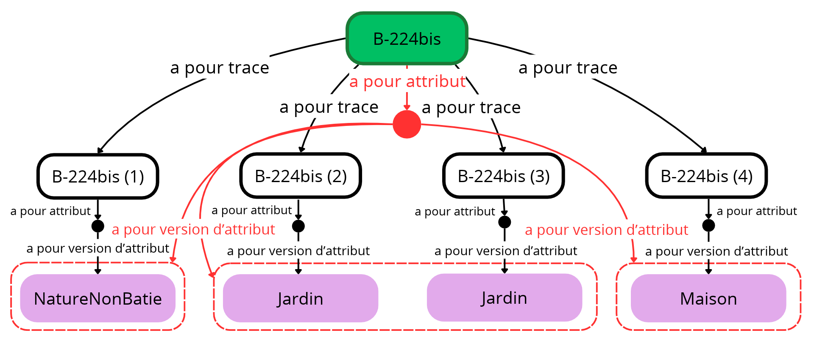
</figure>

## Évolution du quartier de la Butte-aux-Cailles entre 1811 et 1860

**Quelles sont les parcelles contenant une ou plusieurs maisons ?**

<figure style="text-align: center;">
    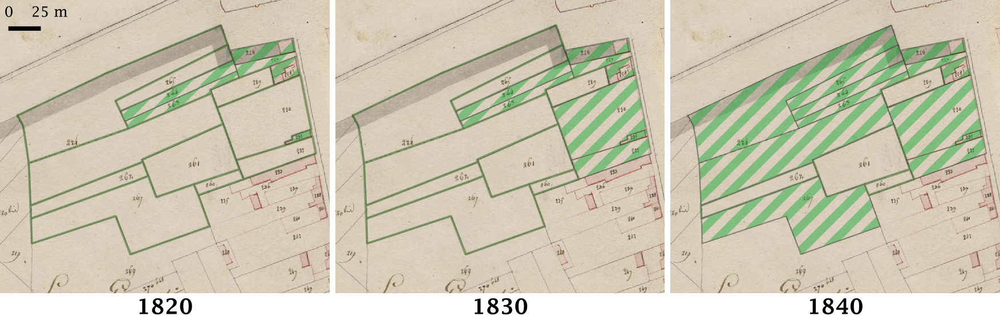
</figure>

## Évolution du quartier de la Butte-aux-Cailles entre 1811 et 1860

**Quelles sont les parcelles contenant une ou plusieurs maisons ?**

<figure style="text-align: center;">
    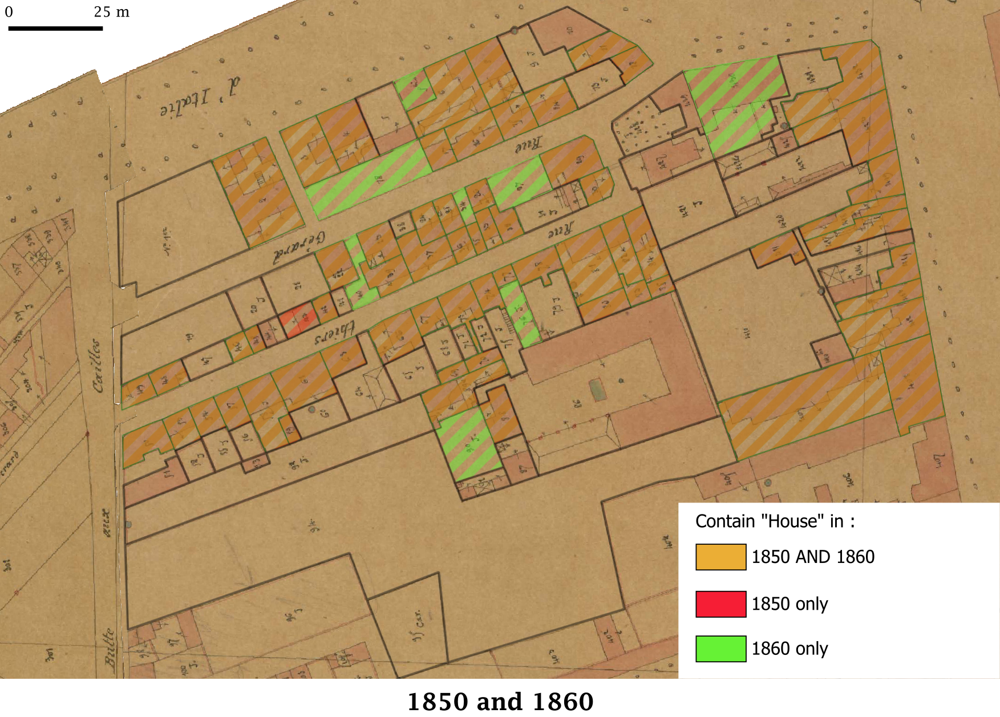
</figure>

## Évolution du quartier de la Butte-aux-Cailles entre 1811 et 1860

**Quelles sont les parcelles contenant une ou plusieurs maisons ?**

<figure style="text-align: center;">
    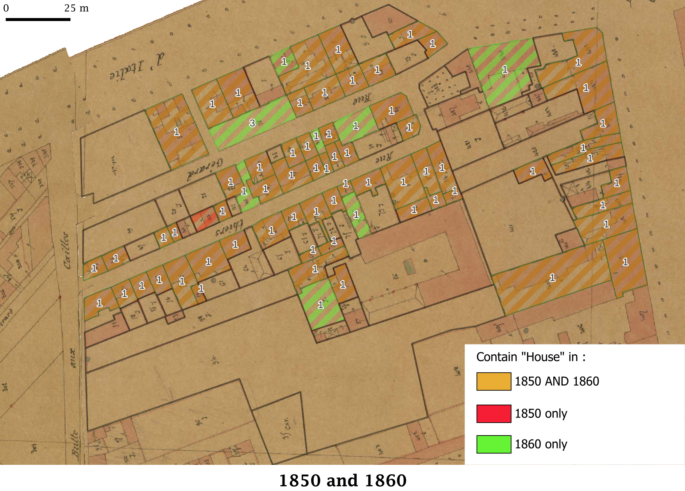
</figure>

## Évolution du quartier de la Butte-aux-Cailles entre 1811 et 1860

**Quelles sont les natures des propriétés bâties ?**

<figure style="text-align: center;">
    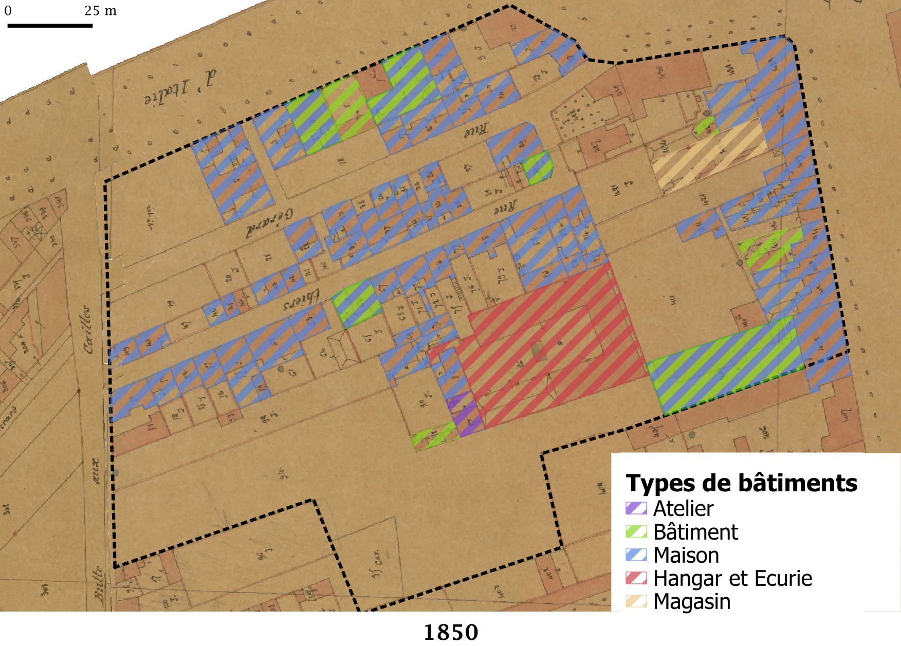
</figure>

## Évolution du quartier de la Butte-aux-Cailles entre 1811 et 1860

**Quelles sont les voies associées aux parcelles ?**

<figure style="text-align: center;">
    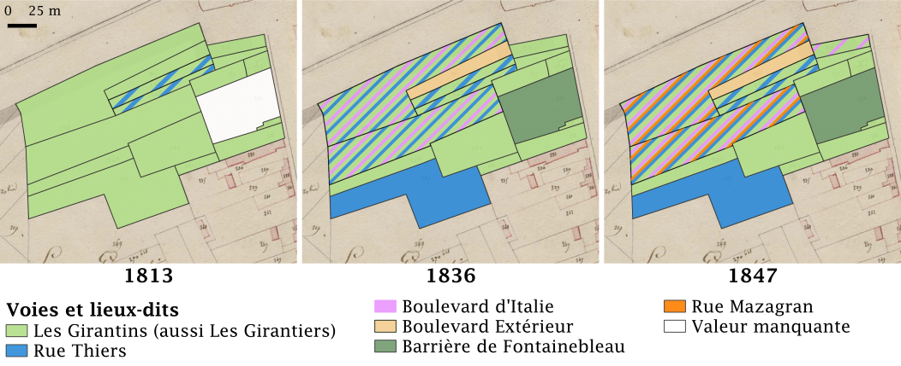
</figure>

## Évolution du quartier de la Butte-aux-Cailles entre 1811 et 1860

**Quelles sont les voies associées aux parcelles ?**

<figure style="text-align: center;">
    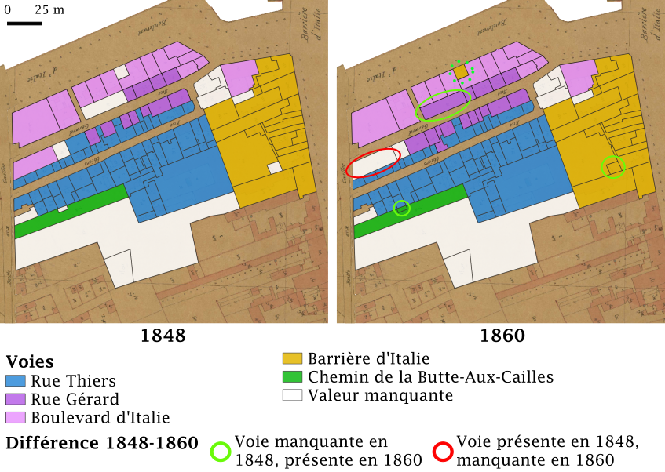
</figure>

## Évolution du quartier de la Butte-aux-Cailles entre 1811 et 1860

**Quelle est l'évolution de la parcelle D-40 entre 1848 et 1860 ?**

:::{.mermaid-fit style="--h: 400px; --zoom: 1.6"}
```{mermaid}
%%{init: {'themeCSS': '.done0 { fill: #ab5fcb !important; stroke: #6c3483 !important; } .done1 { fill: #5695dc !important; stroke: #1b4f72 !important; } .done2 { fill: #cb7167 !important; stroke: #922b21 !important; } .doneText0, .doneText1, .doneText2 { fill: #ffffff !important; }'}}%%
gantt
    dateFormat  YYYY-MM-DD
    axisFormat  %Y
    tickInterval 5year

    section Nature
    Sol et cour:done, 1848-01-01, 1860-12-31
    Maison:done, 1849-01-01, 1860-12-31
    section Adresse
    2 rue Gérard :done, 1848-01-01, 1860-12-31
    section Contribuable
    François Odhemet :done, 1848-01-01, 1860-12-31
```
:::

<div style="text-align: center;"><em>La maison est construite en 1847-1848. Le contribuable n'apparaît pas dans le cadastre précédent.</em></div>

## Évolution du quartier de la Butte-aux-Cailles entre 1811 et 1860

**Quelles sont les parcelles pour lesquelles le contribuable <em>François Clopt</em> est redevable de l'impôt foncier ?**

:::{.mermaid-fit style="--h: 400px; --zoom: 1.6"}
```{mermaid}
%%{init: {'themeCSS': '.done0, .done1 { fill: #77bd59 !important; stroke: #107a27 !important; } .doneText0, .doneText1 { fill: #ffffff !important; }'}}%%
gantt
    dateFormat  YYYY-MM-DD
    axisFormat  %Y
    tickInterval 5year

    section 1er cadastre
    B-263 (Maison):done, 1836-01-01, 1848-06-30
    section 2nd cadastre
    D-36 (Maison, Sol et cour) :done, 1848-07-01, 1860-12-31
```
:::

<div style="text-align: center;"><em>Il s'agit probablement de la même parcelle dans deux cadastres différents, le contribuable n'ayant pas d'autres propriétés.</em></div>

## Questions de recherche
::: {.nonincremental}
2. Quelle **méthode utiliser pour organiser des connaissances isolées sur chaque attribut de chaque parcelle suivant une logique spatio-temporelle adaptée** ? ✅
<center>
    <figure>
        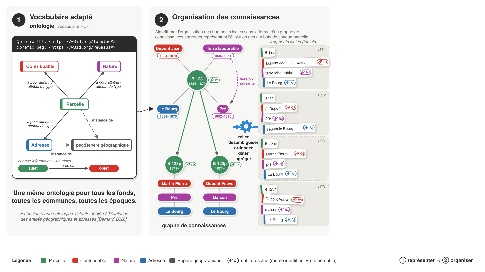
    </figure>
</center>
:::

## Questions de recherche
::: {.nonincremental}
3. Comment **extraire automatiquement les informations à partir des tables manuscrites** (au contenu et à la structure variables) ?
<center>
    <figure>
        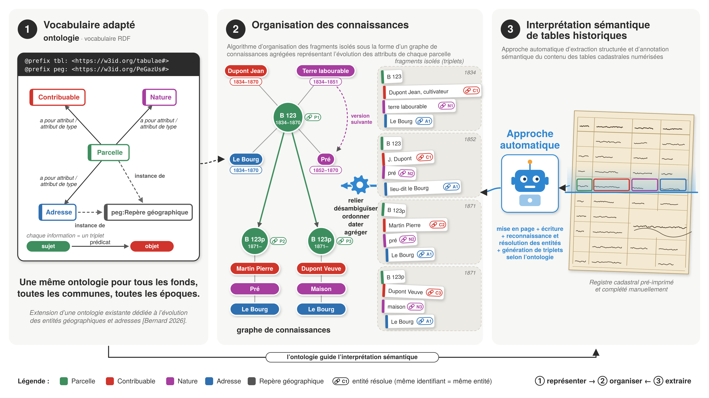
    </figure>
</center>
:::