# IV. Extraction structurée des connaissances contenues dans le cadastre ancien {data-short="IV. Extraction et structuration"}
Exemple appliqué aux registres d'états de sections.

## Variabilité structurelle

:::: {.columns .fullwidth}
::: {.column width="33%"}

<figure style="text-align: center;">
    <figcaption>État de sections de Marolles (1810). AD 94, 3 P 387.</figcaption>
    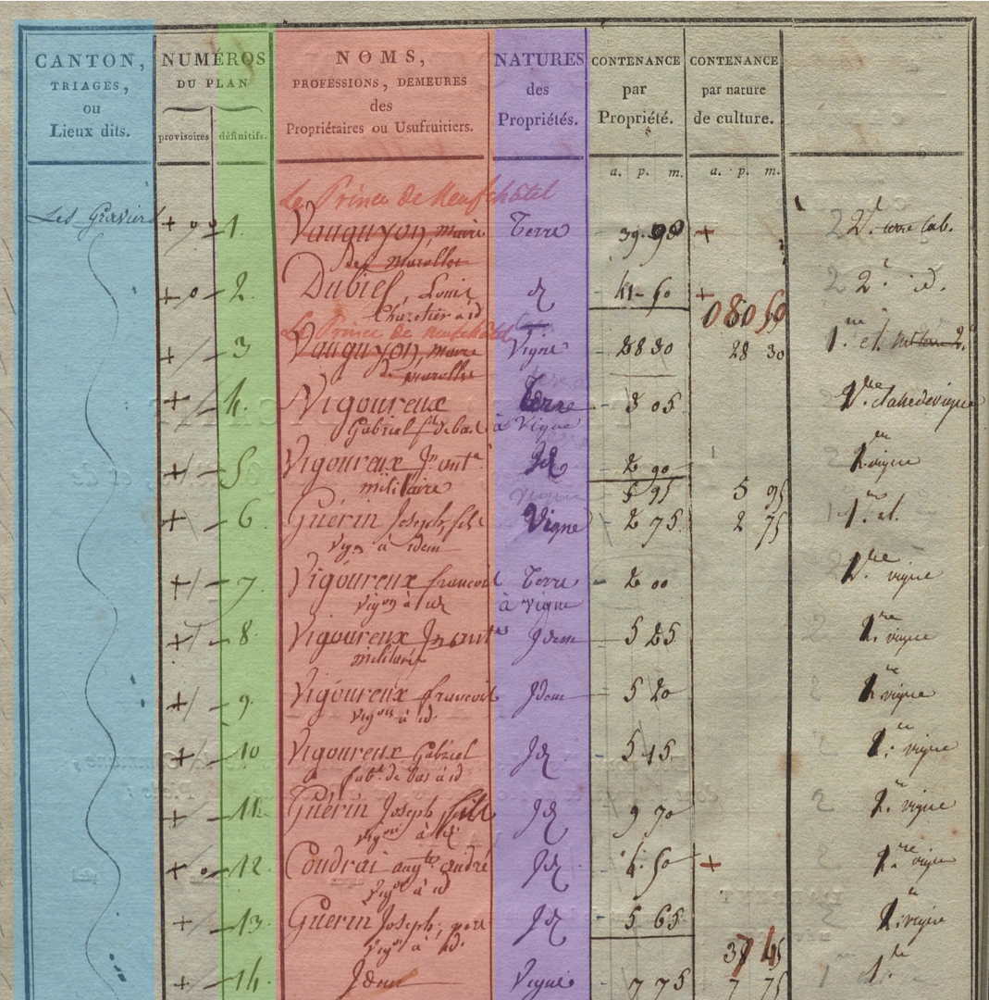
</figure>
:::

::: {.column width="33%"}

<figure style="text-align: center;">
    <figcaption>État de sections de L'Haÿ (1842). AD 94, 3 P 275.</figcaption>
    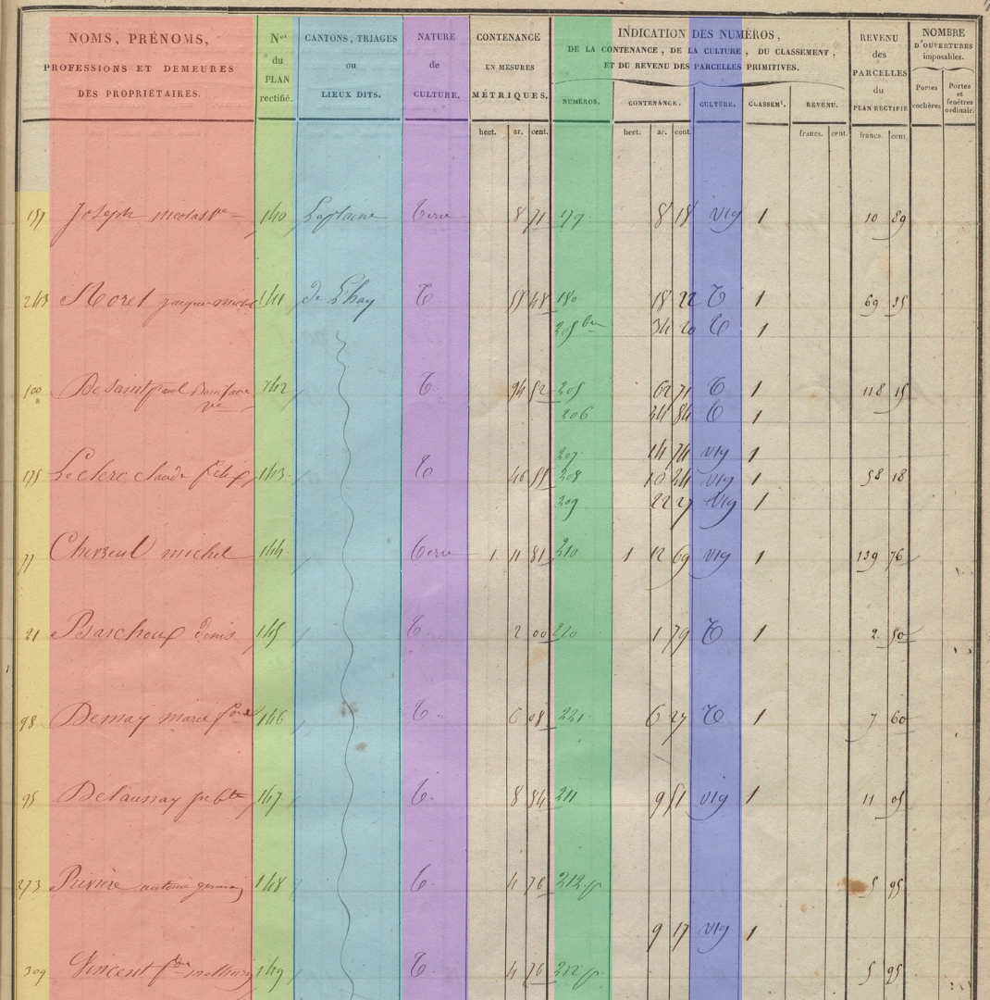
</figure>

:::

::: {.column width="33%"}

<figure style="text-align: center;">
    <figcaption>État de sections de Charenton-le-Pont (1860). AD 94, 3 P 141.</figcaption>
    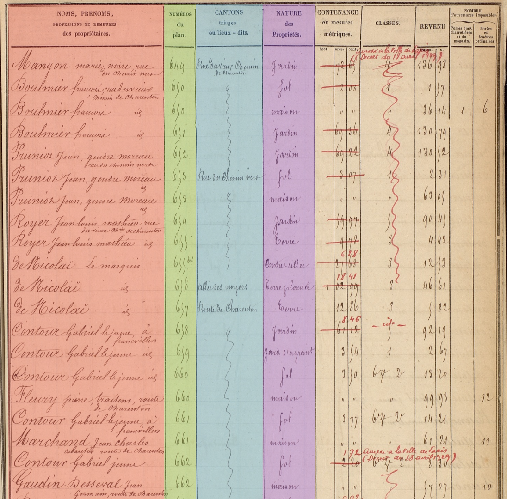
</figure>

:::

::::

<div class="color-legend" style="display: flex; flex-wrap: wrap; justify-content: center; gap: 0.6em 2.2em; font-size: 0.55em; margin-top: 0.3em;">
  <span style="display: inline-flex; align-items: center; gap: 0.35em;"><span style="display: inline-block; width: 1em; height: 1em; border-radius: 3px; background: #e41a1c;"></span>Contribuable</span>
  <span style="display: inline-flex; align-items: center; gap: 0.35em;"><span style="display: inline-block; width: 1em; height: 1em; border-radius: 3px; background: #377eb8;"></span>Adresse de la parcelle</span>
  <span style="display: inline-flex; align-items: center; gap: 0.35em;"><span style="display: inline-block; width: 1em; height: 1em; border-radius: 3px; background: #5bc058;"></span>Numéro de parcelle</span>
  <span style="display: inline-flex; align-items: center; gap: 0.35em;"><span style="display: inline-block; width: 1em; height: 1em; border-radius: 3px; background: #984ea3;"></span>Nature</span>
  <span style="display: inline-flex; align-items: center; gap: 0.35em;"><span style="display: inline-block; width: 1em; height: 1em; border-radius: 3px; background: #ffff33;"></span>Numéro du contribuable dans la matrice</span>
  <span style="display: inline-flex; align-items: center; gap: 0.35em;"><span style="display: inline-block; width: 1em; height: 1em; border-radius: 3px; background: #177e21;"></span>Ancien numéro de parcelle</span>
  <span style="display: inline-flex; align-items: center; gap: 0.35em;"><span style="display: inline-block; width: 1em; height: 1em; border-radius: 3px; background: #283aa1;"></span>Ancienne nature</span>
</div>

::: {.notes}
- En parcourant les documents de plusieurs communes, dans plusieurs départements à différentes dates, on constate que la structure des tables a changé au cours du temps et selon les départements.
:::

## Variabilité structurelle

:::: {.columns .fullwidth}
::: {.column width="50%"}

<figure style="text-align: center;">
    <figcaption>Extrait de l'état de sections de l'Île-de-Batz (1810). <em>AD 29, 3 P 85 4.</em>
    </figcaption>
    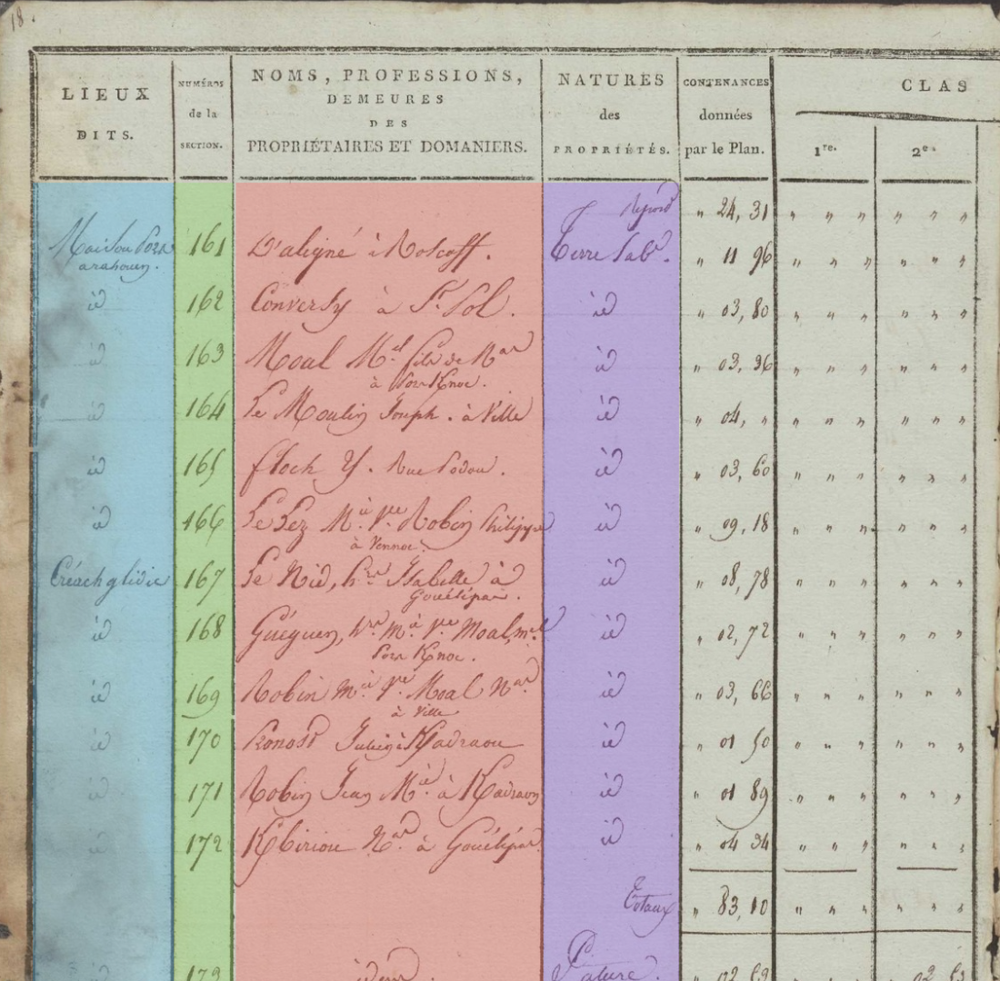
</figure>
:::

::: {.column width="50%"}

<figure style="text-align: center;">
    <figcaption>Extrait de l'état de sections d'Ouessant (1842). <em>AD 29, 3 P 156.</em>
    </figcaption>
    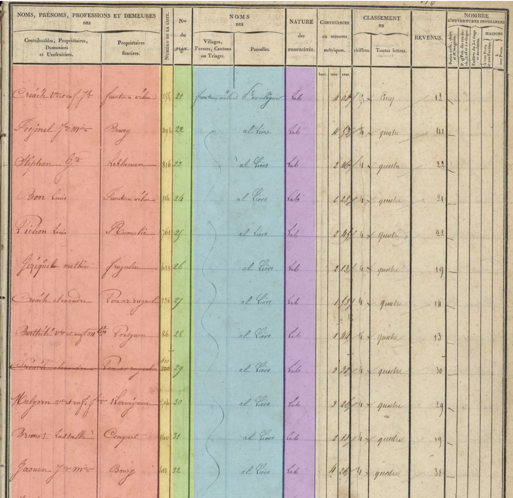
</figure>

:::

::::

<div class="color-legend" style="display: flex; flex-wrap: wrap; justify-content: center; gap: 0.6em 2.2em; font-size: 0.55em; margin-top: 0.3em;">
  <span style="display: inline-flex; align-items: center; gap: 0.35em;"><span style="display: inline-block; width: 1em; height: 1em; border-radius: 3px; background: #e41a1c;"></span>Contribuable</span>
  <span style="display: inline-flex; align-items: center; gap: 0.35em;"><span style="display: inline-block; width: 1em; height: 1em; border-radius: 3px; background: #377eb8;"></span>Adresse de la parcelle</span>
  <span style="display: inline-flex; align-items: center; gap: 0.35em;"><span style="display: inline-block; width: 1em; height: 1em; border-radius: 3px; background: #5bc058;"></span>Numéro de parcelle</span>
  <span style="display: inline-flex; align-items: center; gap: 0.35em;"><span style="display: inline-block; width: 1em; height: 1em; border-radius: 3px; background: #984ea3;"></span>Nature</span>
  <span style="display: inline-flex; align-items: center; gap: 0.35em;"><span style="display: inline-block; width: 1em; height: 1em; border-radius: 3px; background: #ffff33;"></span>Numéro du contribuable dans la matrice</span>
</div>

## Variabilité structurelle

<figure style="text-align: center;">
    <figcaption>Dates de création du cadastre des communes du Finistère.<br/><em>Si plusieurs cadastres successifs : seule la date du premier cadastre est représentée. Source : <a href="">documentation AD29</a></em></figcaption>
    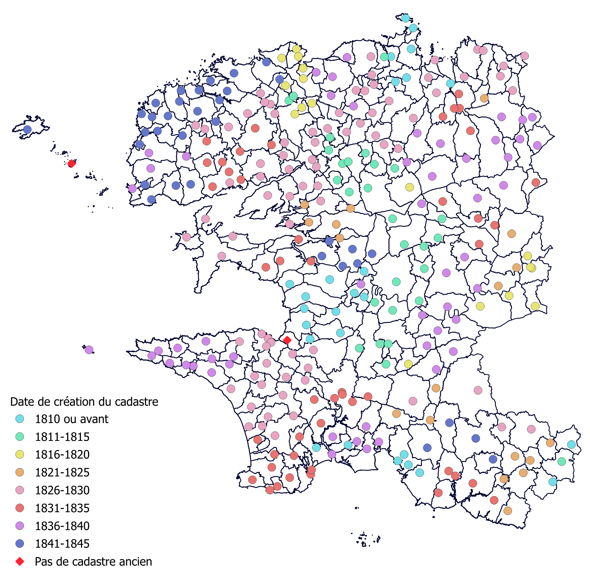
</figure>

## Mise en page

<figure style="text-align: center;">
    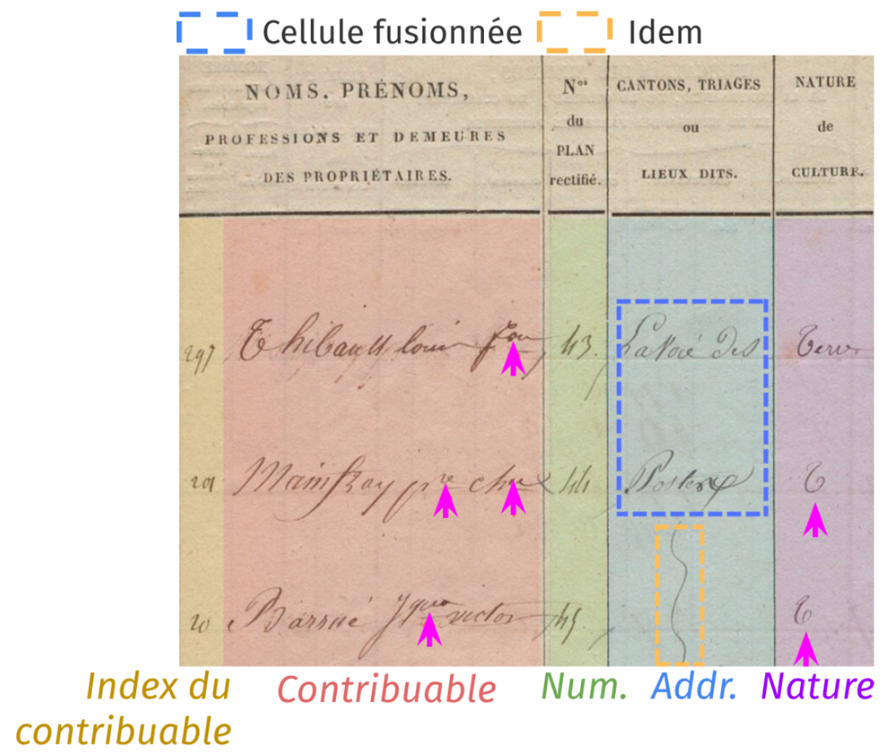
    <figcaption>État de sections de L'Haÿ. <em>Source : <a href="">AD94</a></em></figcaption>
</figure>

## Processus

<div class="shape-legend" style="display: flex; flex-wrap: wrap; justify-content: center; align-items: center; gap: 0.6em 2.2em; font-size: 0.6em; margin-top: 0.3em;">
  <span style="display: inline-flex; align-items: center; gap: 0.4em;"><svg width="1.6em" height="1.2em" viewBox="0 0 32 24"><path d="M3,3 H29 V18 C22,13 15,24 9,20 C6,18 4,19 3,20 Z" fill="#E3F2E7" stroke="#17632F" stroke-width="2.5"/></svg>Données</span>
  <span style="display: inline-flex; align-items: center; gap: 0.4em;"><svg width="1.6em" height="1.2em" viewBox="0 0 32 24"><rect x="3" y="4" width="26" height="16" rx="4" fill="#DCEBF8" stroke="#135385" stroke-width="2.5"/></svg>Traitement</span>
  <span style="display: inline-flex; align-items: center; gap: 0.4em;"><svg width="1.6em" height="1.2em" viewBox="0 0 32 24"><path d="M16,2 L28,12 L16,22 L4,12 Z" fill="#FCE9CC" stroke="#B36B00" stroke-width="2.5"/></svg>Filtre</span>
  <span style="display: inline-flex; align-items: center; gap: 0.4em;"><svg width="1.6em" height="1.2em" viewBox="0 0 32 24"><path d="M3,3 H29 V18 C22,13 15,24 9,20 C6,18 4,19 3,20 Z" fill="#F6E1F3" stroke="#8A3A80" stroke-width="2.5" stroke-dasharray="4 3"/></svg>Modèle de référence</span>
  <span style="display: inline-flex; align-items: center; gap: 0.4em;"><svg width="1.6em" height="1.2em" viewBox="0 0 32 24"><line x1="2" y1="12" x2="24" y2="12" stroke="#555" stroke-width="3"/><path d="M23,7 L30,12 L23,17 Z" fill="#555"/></svg>Sens de la chaîne de traitement</span>
  <span style="display: inline-flex; align-items: center; gap: 0.4em;"><svg width="1.6em" height="1.2em" viewBox="0 0 32 24"><line x1="2" y1="12" x2="24" y2="12" stroke="#8A3A80" stroke-width="2.5" stroke-dasharray="3 3"/><path d="M23,7 L30,12 L23,17 Z" fill="#8A3A80"/></svg>Utilisation de l'ontologie</span>
</div>

::: {.column-page .mermaid-fit .full-width}
```{mermaid}
%%{init: {"themeVariables": {"fontSize": "26px"}, "flowchart": {"rankSpacing": 40, "nodeSpacing": 30, "padding": 12, "diagramPadding": 4, "wrappingWidth": 400, "curve": "basis"}}}%%
flowchart LR

    %% Données (entrées / sorties)
    Cote@{ shape: docs, label: "Registre<br>numérisé" }
    Image@{ shape: doc, label: "Image<br><small>(page)</small>" }
    TablesTranscrites@{ shape: doc, label: "Tables transcrites<br><small>avec types des infos. reconnues</small>" }
    TableAnnotee@{ shape: doc, label: "Table annotée<br><small>selon l'ontologie</small>" }
    KG@{ shape: cyl, label: "Graphe de<br> connaissances" }

    %% Modèle de référence
    Ontologie@{ shape: tag-doc, label: "Ontologie" }

    %% Traitements
    Classifieur@{ shape: rounded, label: "Classification<br>des images" }
    ExtractionStructuree@{ shape: rounded, label: "Extraction des informations<br><small>Transcription par lignes des cellules<br>des colonnes d’intérêt</small>" }
    DetectionDesEntites@{ shape: rounded, label: "Résolution<br>des entités" }
    GenerationTriplets@{ shape: rounded, label: "Génération<br>de triplets" }

    %% Filtre / décision
    Filtre@{ shape: diam, label: "Table<br>principale ?" }
    Ignore@{ shape: stadium, label: "<small>Page écartée</small>" }

    %% Ligne 1 : sélection des pages
    Cote -- contient --> Image
    Image --> Classifieur
    Classifieur --> Filtre
    %% Retour à la ligne : flèche déclarée à l'envers (Extraction <-> Filtre)
    %% pour que la 2e ligne reparte à gauche ; la pointe côté Filtre est masquée (linkStyle 3).
    ExtractionStructuree <-- Oui --> Filtre
    Filtre -. Non .-> Ignore

    %% Ligne 2 : extraction et structuration
    ExtractionStructuree --> TablesTranscrites
    TablesTranscrites --> DetectionDesEntites
    DetectionDesEntites --> TableAnnotee
    TableAnnotee --> GenerationTriplets
    GenerationTriplets --> KG

    %% Rôle de l'ontologie
    Ontologie -..-> Classifieur
    Ontologie -..-> ExtractionStructuree
    Ontologie -..-> DetectionDesEntites
    Ontologie -..-> GenerationTriplets

    %% Contrainte de mise en page (invisible) : Extraction sous Image
    ExtractionStructuree ~~~ Classifieur

    classDef data fill:#E3F2E7,stroke:#17632F,stroke-width:3px,color:#0F3D1D;
    classDef process fill:#DCEBF8,stroke:#135385,stroke-width:3px,color:#0B2F4D;
    classDef filter fill:#FCE9CC,stroke:#B36B00,stroke-width:3px,color:#5C3700;
    classDef model fill:#F6E1F3,stroke:#8A3A80,stroke-width:3px,color:#4A1A44,stroke-dasharray:6 4;
    classDef sink fill:#F2F2F2,stroke:#999,stroke-width:2px,color:#666;

    class Cote,Image,TablesTranscrites,TableAnnotee,KG data;
    class Classifieur,ExtractionStructuree,DetectionDesEntites,GenerationTriplets process;
    class Filtre filter;
    class Ontologie model;
    class Ignore sink;

    linkStyle 0,1,2,5,6,7,8,9 stroke:#555,stroke-width:3px;
    linkStyle 3 stroke:#555,stroke-width:3px,marker-end:none;
    linkStyle 4 stroke:#999,stroke-width:2px;
    linkStyle 10,11,12,13 stroke:#8A3A80,stroke-width:2px;
```
:::

## Interprétation sémantique de tables

Interprétation sémantique de tables : exemple des états de sections.
<br/>
<figure style="text-align: center;">
    <figcaption> Chaque élément (ou association d'éléments) de la table transcrite est associé à un concept, à une propriété ou à un type de valeur (texte, nombre entier, etc.) décrit dans l'ontologie TABULAE.</figcaption>
    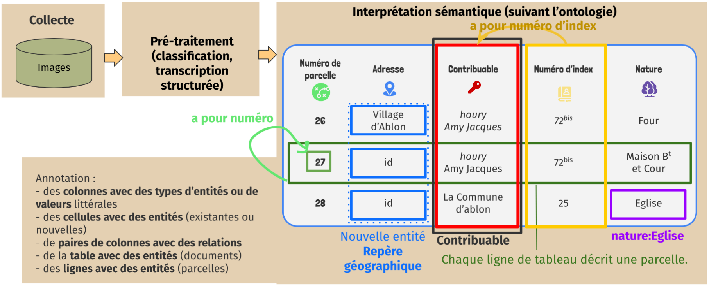
</figure>

## Interprétation sémantique de tables

Un registre contient plusieurs types de pages : une phase de classification est nécessaire. Les classes de pages sont définies dans l'ontologie TABULAE.
<br/>
<br/>
<figure style="text-align: center;">
    <figcaption>Exemple de types de pages dans un registre d'états de sections.</figcaption>
    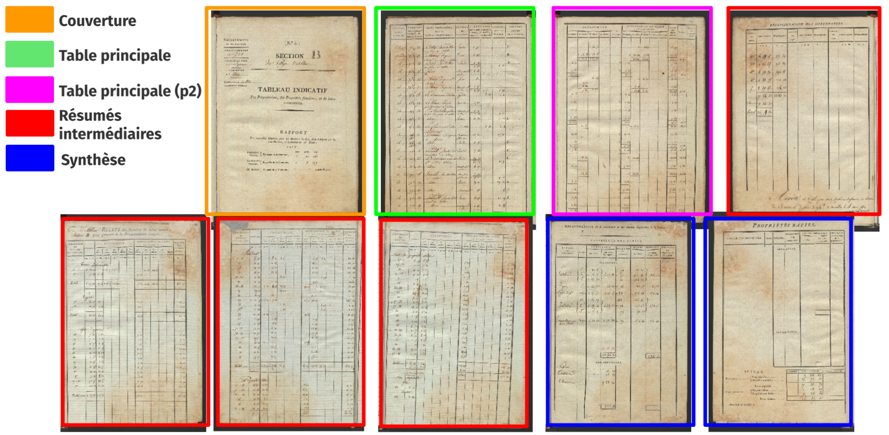
</figure>

## Interprétation sémantique de tables

Image -> texte structuré : extraction d'informations.
<br/>
<br/>
<figure style="text-align: center;">
    <figcaption>Principales étapes de la phase d'extraction d'informations.</figcaption>
    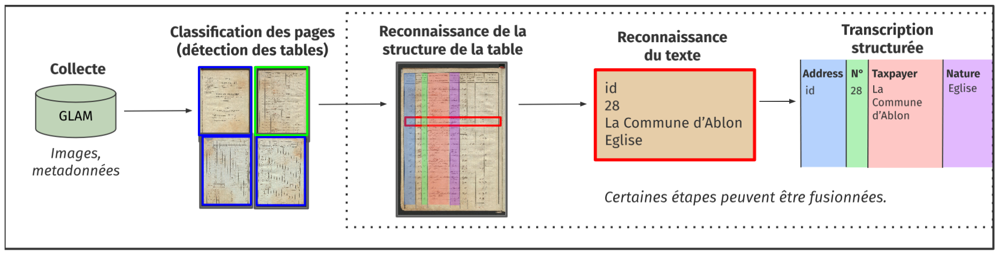
</figure>

## Interprétation sémantique de tables

:::{.nonincremental}
**Résolution des entités** (contribuable, repères géographiques, natures de parcelles) :
:::

<figure style="text-align: center;">
    <figcaption>Liage des valeurs extraites avec des entités existantes ou création de nouvelles entités.</figcaption>
    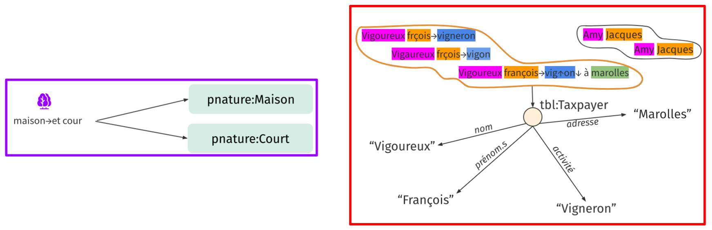
</figure>

## Implémentation

::::{.columns}

:::{.nonincremental .column width="50%"}

**Classification**

* Modèle : YOLOv11 (@yolo)
* Nombre d'images annotées : 1046
* F1-Score : 99.3% (de réussite)

::: {.dataset}
[A dataset for 19th-century French land registry pages classification (v2)]{.dataset-title}
[2026]{.dataset-date}
[https://zenodo.org/records/18767594](zenodo.org/records/18767594){.dataset-url}
:::

::: {.dataset}
[A YOLOv11 model dedicated to classification of 19th-century French Land Registry pages]{.dataset-title}
[2026]{.dataset-date}
[https://zenodo.org/records/18799034](zenodo.org/records/18799034){.dataset-url}
:::

:::

:::{.nonincremental .column width="50%"}

**Extraction d'informations**

* Modèle : DAN (@dan)
* Nombre d'images annotées : 147
* Taux d'erreur par caractère : 
    * moyenne : 35.3%
    * min : 7.4% | max : 178.15%

::: {.dataset}
[A dataset for information extraction from land registry tables]{.dataset-title}
[2025]{.dataset-date}
[https://zenodo.org/records/15411507](zenodo.org/records/15411507){.dataset-url}
:::

::: {.dataset}
[A DAN model for Information Extraction from land registry tables]{.dataset-title}
[2025]{.dataset-date}
[https://zenodo.org/records/17185990](zenodo.org/records/17185990){.dataset-url}
:::
:::

::::

## Évaluation : étapes intermédiaires

**Extraction d'informations : évaluation qualitative**
<br>
<figure style="text-align: center;">
    <figcaption>Exemple de prédictions (phase d'extraction d'informations).</figcaption>
    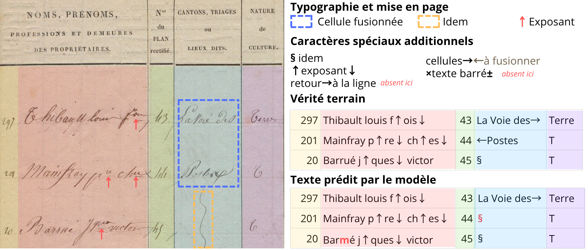
</figure>

## Évaluation : étapes intermédiaires

**Extraction d'informations : évaluation quantitative**

<figure style="text-align: center;">
    <figcaption>Taux d'erreur par caractère sur le groupe de pages dédié au test (valeur basse = bonne performance).</figcaption>
    <br>
    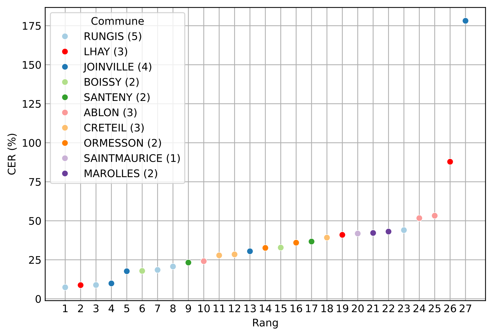
</figure>

## Évaluation : étapes intermédiaires

**Extraction d'informations**

::::{.columns}

:::{.nonincremental .column width="50%"}

<figure style="text-align: center;">
    <figcaption>2e CER le plus bas (meilleur)</figcaption>
    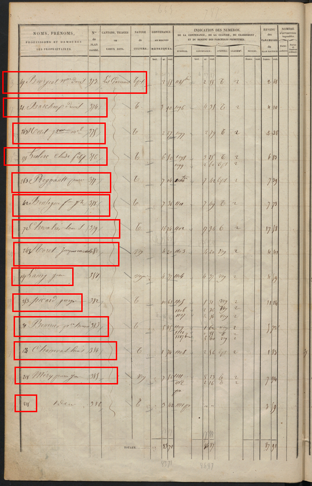
</figure>

:::

:::{.nonincremental .column width="50%"}
<figure style="text-align: center;">
    <figcaption>CER le plus élevé</figcaption>
    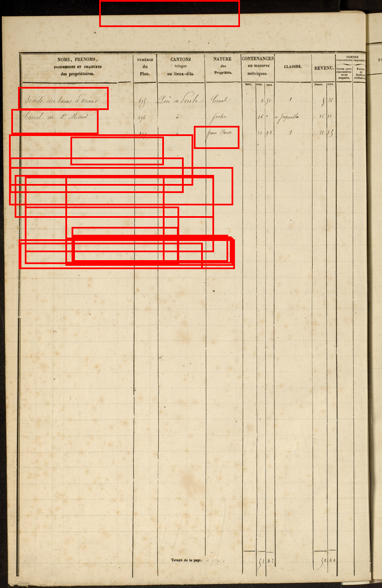
</figure>
:::
::::

## Évaluation : étapes intermédiaires

**Extraction d'informations**

<figure style="text-align: center;">
    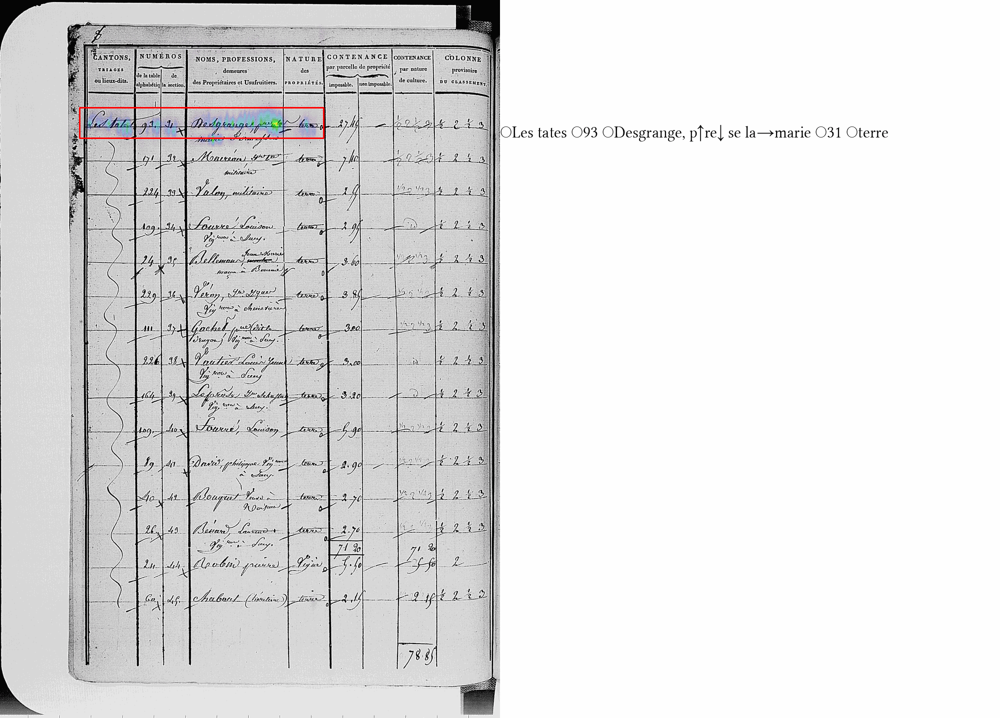
</figure>

## Évaluation : étapes intermédiaires

**Reconnaissance des entités nommées**

::::{.columns}

:::{.nonincremental .column width="33%"}
* Modèle : CamemBERT (@camembert)
* Nombre d'exemples annotés : 2625
* F1-Score : 88.3% (de réussite)
:::

:::{.nonincremental .column width="66%"}

<figure>
    <figcaption>Entités nommées reconnues automatiquement.</figcaption>
    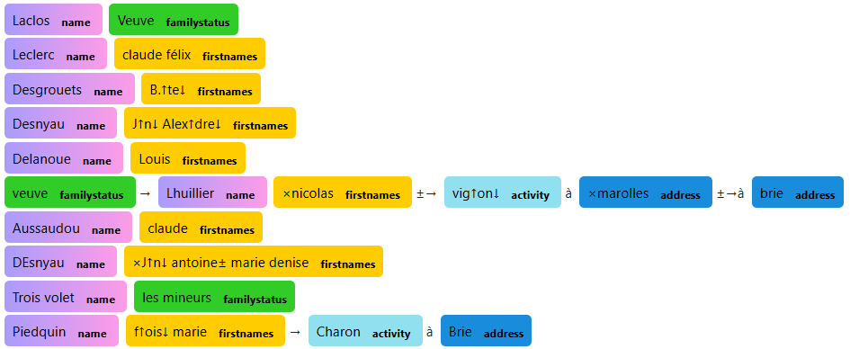
</figure>

:::

::::

## Évaluation du graphe de connaissances

**Résultat final : graphe de connaissances**

::::{.nonincremental}
* Comparaison du graphe de connaissances généré automatiquement avec un graphe de référence construit manuellement.
    * Taux d'accord : entités/triplets attendus et effectivement créés
    * Taux de surplus : entités/triplets créés à tort
    * Taux de déficit : entités/triplets attendus mais non créés
:::

* <span style="color: darkgreen;">100% d'accord pour les entités créées à partir des métadonnées (documents etc.)</span>
* <span style="color: green;">Entre 93,9 et 96% d'accord pour les entités créées à partir des informations correspondant à la structure de la table (lignes = parcelle, cellule = attribut et version d'attribut)</span>
* <span style="color: orange;">60,5 % d'accord pour les entités de contribuables</span>
* <span style="color: red;">47,4 % d'accord pour les entités de repères géographiques correspondant aux adresses des parcelles</span>

## Évaluation du graphe de connaissances

**Exemple de la section C de L'Haÿ : natures de parcelles**

::::{.columns}

:::{.nonincremental .column width="50%"}
<figure style="text-align: center;">
    <figcaption>D'après le graphe de connaissances généré automatiquement.</figcaption>
    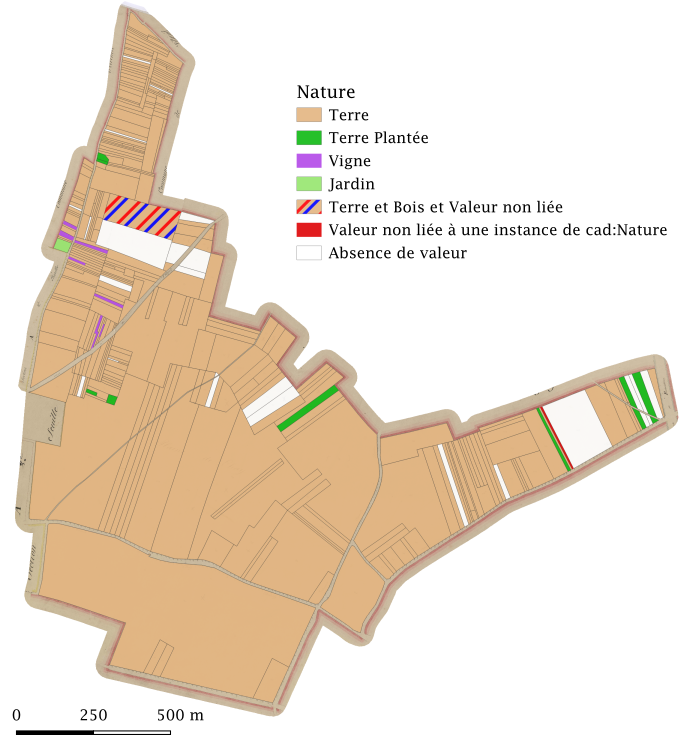
</figure>
:::

:::{.nonincremental .column width="50%"}
<figure style="text-align: center;">
    <figcaption>Référence.</figcaption>
    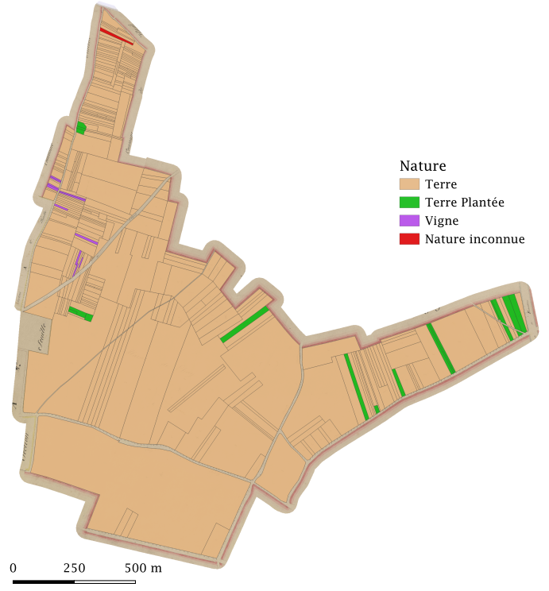
</figure>
:::
::::

## Évaluation du graphe de connaissances

**Exemple de la section C de L'Haÿ : natures de parcelles**

<figure style="text-align: center;">
    <figcaption>Comparaison entre le graphe de connaissances généré automatiquement et le graphe de référence construit manuellement.</figcaption>
    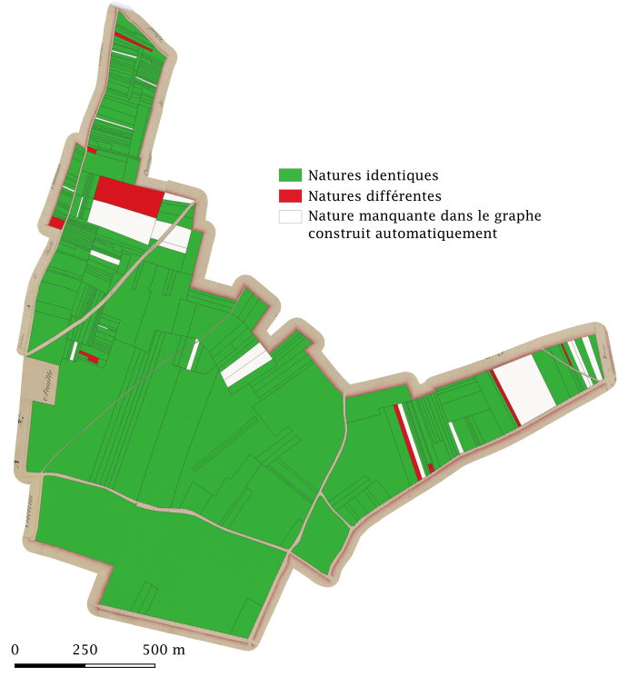
</figure>