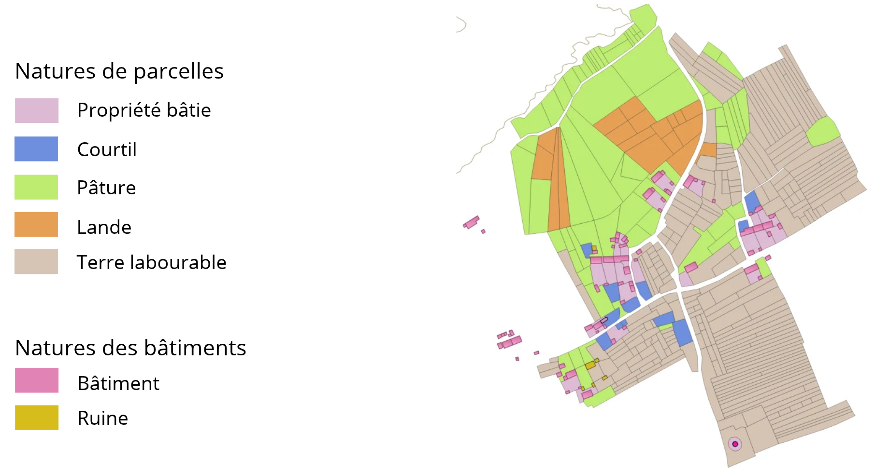
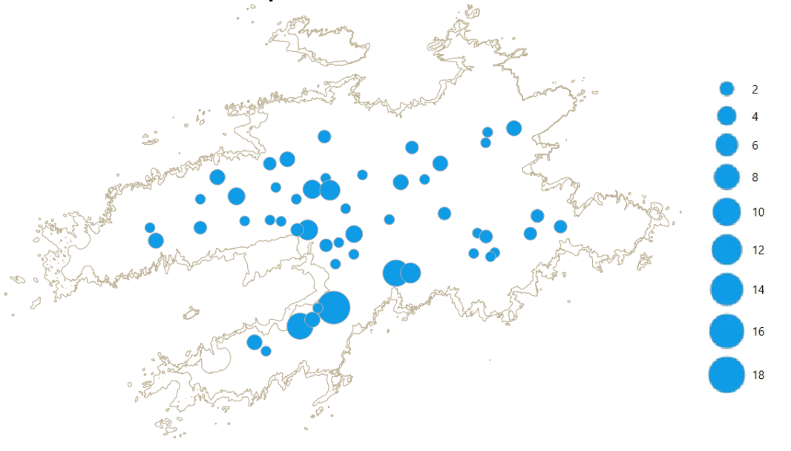
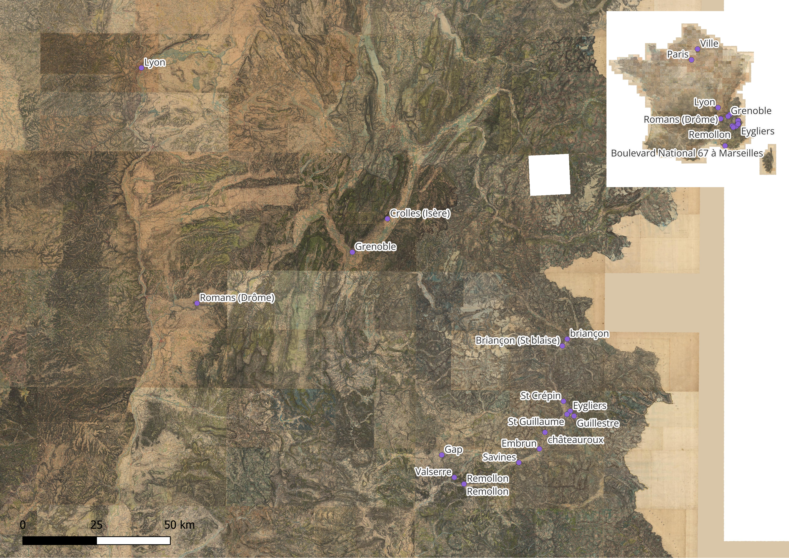
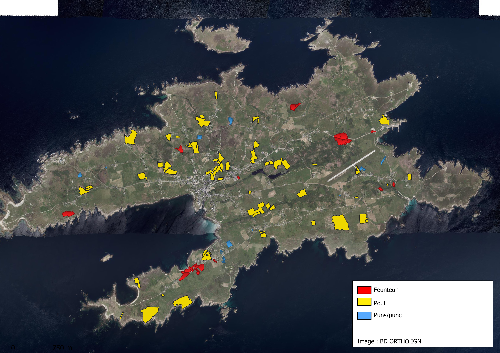
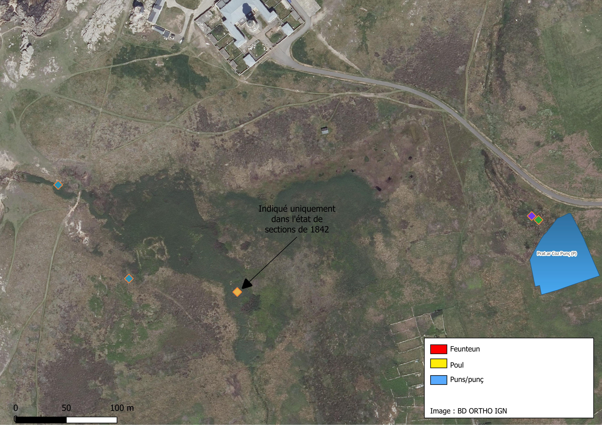
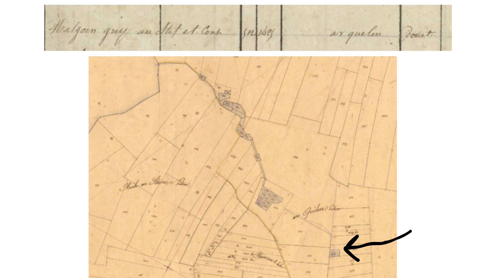

# V. Observations sur les repères géographiques mentionnés dans le cadastre {data-short="V. Complément sur les repères géographiques"}

## Adresses des contribuables et des parcelles
**Exemple 1 : Ouessant**

<figure style="text-align:center">
    <figcaption>Parcelles et bâtiments du hameau de Toulalan (Ouessant, 29) et leur nature en 1842.</figcaption>
    
</figure>

## Adresses des contribuables et des parcelles
**Exemple 1 : Ouessant**

<figure style="text-align:center">
    <figcaption>Adresses des contribuables disposant de parcelles dans le hameau de Toulalan (Ouessant, 29) et nombre de contribuables par adresse.</figcaption>
    
</figure>

## Adresses des contribuables et des parcelles
**Exemple 2 : Mont-Dauphin**

<figure style="text-align:center">
    <figcaption>Regroupements d'adresses (de parcelles et de contribuables)dans le cadastre de Mont-Dauphin.</figcaption>
    
</figure>

## Localisation de repères à partir des registres cadastraux

<figure style="text-align:center">
    <figcaption>Noms de lieux issus des plans (et partiellement des registres cadastraux) pouvant être associés à des lavoirs/puits/fontaines.</figcaption>
    
</figure>

## Localisation de repères à partir des registres cadastraux

<figure style="text-align:center">
    <figcaption>Pièce d'eau caractérisée en douet à l'aide des du registre d'états de sections.</figcaption>
    
</figure>

## Localisation de repères à partir des registres cadastraux

<figure style="text-align:center">
    <figcaption>Pièce d'eau caractérisée en douet à l'aide des du registre d'états de sections. Source : AD29.</figcaption>
    
</figure>

